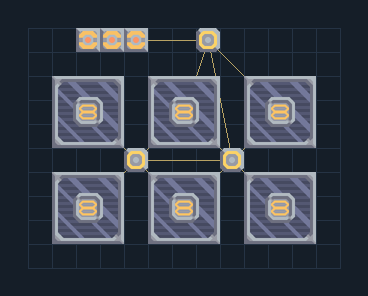

# โซลาร์เริ่มระบบ — แบตเตอรี่และเสา

**POWER201** · 04 ไฟฟ้า · 13×10 ช่อง · **ตรวจผัง**

ไฟเริ่มปั๊ม/ประจุแบตเตอรี่โดยไม่ใช้เชื้อเพลิง  
ใช้กลางวันและตรวจแสงของแผนที่ ชาร์จแบตเตอรี่ก่อนต่อโหลดหนัก ไม่รับประกันเริ่ม Impact ทุกชุดจากแผงนี้เพียงชุดเดียว  
  
จุดต่อก่อนหมุน (0,0 มุมซ้ายล่าง):  
ต่อไฟออกเมื่อแบตเตอรี่ชาร์จ @ 7,9  
Serpulo • ไทย 2.0 • บล็อกเดิม • สร้างใหม่  
สถานะ: โครงสร้าง; ยังไม่ยืนยันการต่อสู้/กำลังผลิตจริง  
  
หมวด: 04 ไฟฟ้า • Serpulo ไทย 2.0

**วัสดุก่อสร้าง:** ทองแดง 21 · ตะกั่ว 438 · ผ้าเฟส 90 · ซิลิคอน 420

[ดาวน์โหลด .msch](../../schematics/POWER201.msch) · [รหัสนำเข้าจากคลิปบอร์ด](../../codes/POWER201.txt) · [กลับสารบัญ](../INDEX.md)

ภาพประกอบใช้กราฟิกบล็อกจากตัวเกม ไม่ใช่ภาพการรบระหว่างเล่นจริง ทางป้อนต้องจ่ายวัตถุดิบและไฟตามเงื่อนไขที่ระบุ
