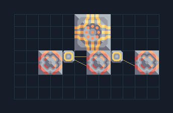

# เทอร์มอล — แผงบนพื้นร้อนและไฟสำรอง

**POWER202** · 04 ไฟฟ้า · 12×7 ช่อง · **ตรวจผัง**

ไฟจากพื้นร้อนสำหรับจุดที่มี Magma/Slag  
วาง Thermal Generator บนพื้นร้อนที่ประสิทธิภาพดี ตัวเลขจริงขึ้นกับพื้นและแผนที่ มีแบตเตอรี่พักไฟ ต่อเสาออกไปฐาน  
  
จุดต่อก่อนหมุน (0,0 มุมซ้ายล่าง):  
ไฟออกจากพื้นร้อน @ 4,3  
Serpulo • ไทย 2.0 • บล็อกเดิม • สร้างใหม่  
สถานะ: โครงสร้าง; ยังไม่ยืนยันการต่อสู้/กำลังผลิตจริง  
  
หมวด: 04 ไฟฟ้า • Serpulo ไทย 2.0

**วัสดุก่อสร้าง:** ทองแดง 124 · กราไฟต์ 105 · ตะกั่ว 212 · เมตากลาส 120 · ซิลิคอน 135 · ไทเทเนียม 20

[ดาวน์โหลด .msch](../../schematics/POWER202.msch) · [รหัสนำเข้าจากคลิปบอร์ด](../../codes/POWER202.txt) · [กลับสารบัญ](../INDEX.md)

ภาพประกอบใช้กราฟิกบล็อกจากตัวเกม ไม่ใช่ภาพการรบระหว่างเล่นจริง ทางป้อนต้องจ่ายวัตถุดิบและไฟตามเงื่อนไขที่ระบุ
