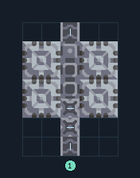

# กราไฟต์ 4 เครื่อง รับถ่านหิน

**PROD-001** · 03 โรงงาน · 5×7 ช่อง · **ทดสอบระบบ**

เหมาะกับ: ป้อนจากสายพาน  
รับ: ถ่านหิน  
ผลผลิต: กราไฟต์  
จุดต่อเมื่อยังไม่หมุน: พิกัดเริ่ม 0 จากซ้ายล่าง  
ถ่านหิน เข้า @ 2,0  
ผลผลิตออก @ 2,6  
ต่อผลผลิตเข้าคลังหรือโรงงานถัดไป เพื่อไม่ให้เครื่องหยุดเพราะทางออกเต็ม  
ผู้สร้างต้นฉบับ: justacommonegg / Design-It (MIT)  
ปรับภาษาไทยและช่องต่อสำหรับชุดนี้  
ตรวจโครงสร้างและการตั้งค่า; อัตราผลิตต้องดูผลทดสอบจริงของแต่ละแบบ  
  
ผลทดสอบ Build 160.7: graphite 2.50/วินาที เมื่อป้อนวัตถุดิบที่จุดต่อและมีไฟครบ  
  
หมวด: 03 โรงงาน • Serpulo ไทย 2.0

**วัสดุก่อสร้าง:** ทองแดง 321 · ตะกั่ว 136

[ดาวน์โหลด .msch](../../schematics/PROD-001.msch) · [รหัสนำเข้าจากคลิปบอร์ด](../../codes/PROD-001.txt) · [กลับสารบัญ](../INDEX.md)

ภาพประกอบใช้กราฟิกบล็อกจากตัวเกม ไม่ใช่ภาพการรบระหว่างเล่นจริง ทางป้อนต้องจ่ายวัตถุดิบและไฟตามเงื่อนไขที่ระบุ
