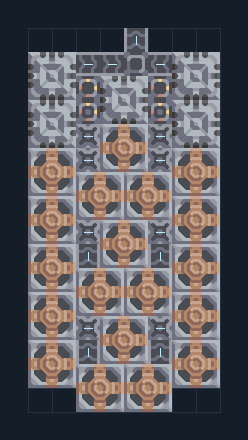

# กราไฟต์จากเหมืองถ่านหิน เริ่มต้น

**PROD-002** · 03 โรงงาน · 8×16 ช่อง · **ทดสอบระบบ**

เหมาะกับ: ขุดและผลิตในชุดเดียว  
รับ:   
ผลผลิต: กราไฟต์  
วางเครื่องเจาะทั้งหมดบนแร่ถ่านหิน ผังนี้สร้างได้ด้วยทองแดงและตะกั่ว  
จุดต่อเมื่อยังไม่หมุน: พิกัดเริ่ม 0 จากซ้ายล่าง  
ผลผลิตออก @ 4,15  
ต่อผลผลิตเข้าคลังหรือโรงงานถัดไป เพื่อไม่ให้เครื่องหยุดเพราะทางออกเต็ม  
ผู้สร้างต้นฉบับ: stan_twitter / Design-It (MIT)  
ปรับภาษาไทยและช่องต่อสำหรับชุดนี้  
ตรวจโครงสร้างและการตั้งค่า; อัตราผลิตต้องดูผลทดสอบจริงของแต่ละแบบ  
  
ผลทดสอบ Build 160.7: graphite 3.27/วินาที เมื่อป้อนวัตถุดิบที่จุดต่อและมีไฟครบ  
  
หมวด: 03 โรงงาน • Serpulo ไทย 2.0

**วัสดุก่อสร้าง:** ทองแดง 673 · ตะกั่ว 208

[ดาวน์โหลด .msch](../../schematics/PROD-002.msch) · [รหัสนำเข้าจากคลิปบอร์ด](../../codes/PROD-002.txt) · [กลับสารบัญ](../INDEX.md)

ภาพประกอบใช้กราฟิกบล็อกจากตัวเกม ไม่ใช่ภาพการรบระหว่างเล่นจริง ทางป้อนต้องจ่ายวัตถุดิบและไฟตามเงื่อนไขที่ระบุ
