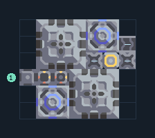

# กราไฟต์ขั้นสูง 2 เครื่อง พร้อมน้ำ

**PROD-005** · 03 โรงงาน · 7×6 ช่อง · **ทดสอบระบบ**

เหมาะกับ: ป้อนจากสายพาน  
รับ: ถ่านหิน  
ผลผลิต: กราไฟต์  
เครื่องสกัดน้ำวางบนพื้นดินที่สร้างได้; ตรวจน้ำจริงหลังเปิดโรงงานและอย่าแบ่งน้ำไปโหลดอื่นจนขาด  
จุดต่อเมื่อยังไม่หมุน: พิกัดเริ่ม 0 จากซ้ายล่าง  
ถ่านหิน เข้า @ 0,2  
ผลผลิตออก @ 6,4  
ไฟฟ้า @ 5,3  
ต่อผลผลิตเข้าคลังหรือโรงงานถัดไป เพื่อไม่ให้เครื่องหยุดเพราะทางออกเต็ม  
ผู้สร้างต้นฉบับ: justacommonegg / Design-It (MIT)  
ปรับภาษาไทยและช่องต่อสำหรับชุดนี้  
ตรวจโครงสร้างและการตั้งค่า; อัตราผลิตต้องดูผลทดสอบจริงของแต่ละแบบ  
  
ผลทดสอบ Build 160.7: graphite 5.00/วินาที เมื่อป้อนวัตถุดิบที่จุดต่อและมีไฟครบ  
  
หมวด: 03 โรงงาน • Serpulo ไทย 2.0

**วัสดุก่อสร้าง:** ทองแดง 84 · กราไฟต์ 160 · ตะกั่ว 282 · เมตากลาส 60 · ซิลิคอน 50 · ไทเทเนียม 200

[ดาวน์โหลด .msch](../../schematics/PROD-005.msch) · [รหัสนำเข้าจากคลิปบอร์ด](../../codes/PROD-005.txt) · [กลับสารบัญ](../INDEX.md)

ภาพประกอบใช้กราฟิกบล็อกจากตัวเกม ไม่ใช่ภาพการรบระหว่างเล่นจริง ทางป้อนต้องจ่ายวัตถุดิบและไฟตามเงื่อนไขที่ระบุ
