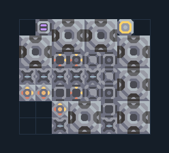

# ซิลิคอน 7 เครื่อง ติดแกนฐาน

**PROD-009** · 03 โรงงาน · 8×7 ช่อง · **ทดสอบระบบ**

เหมาะกับ: ติดแกนฐาน  
รับ: ถ่านหิน, ทราย  
ผลผลิต: ซิลิคอน  
วางแกนฐานหรือคลังขนาด 3×3 ที่จุดกลาง 0,0 ก่อนวางผัง; ทรัพยากรที่ตั้งไว้ในตัวถอดต้องมีอยู่ในคลัง  
จุดต่อเมื่อยังไม่หมุน: พิกัดเริ่ม 0 จากซ้ายล่าง  
ไฟฟ้า @ 6,6  
ต่อผลผลิตเข้าคลังหรือโรงงานถัดไป เพื่อไม่ให้เครื่องหยุดเพราะทางออกเต็ม  
ผู้สร้างต้นฉบับ: susernaeme / Design-It (MIT)  
ปรับภาษาไทยและช่องต่อสำหรับชุดนี้  
ตรวจโครงสร้างและการตั้งค่า; อัตราผลิตต้องดูผลทดสอบจริงของแต่ละแบบ  
  
ผลทดสอบ Build 160.7: silicon 10.50/วินาที เมื่อป้อนวัตถุดิบที่จุดต่อและมีไฟครบ  
  
หมวด: 03 โรงงาน • Serpulo ไทย 2.0

**วัสดุก่อสร้าง:** ทองแดง 288 · กราไฟต์ 5 · ตะกั่ว 237 · ซิลิคอน 90 · ไทเทเนียม 75

[ดาวน์โหลด .msch](../../schematics/PROD-009.msch) · [รหัสนำเข้าจากคลิปบอร์ด](../../codes/PROD-009.txt) · [กลับสารบัญ](../INDEX.md)

ภาพประกอบใช้กราฟิกบล็อกจากตัวเกม ไม่ใช่ภาพการรบระหว่างเล่นจริง ทางป้อนต้องจ่ายวัตถุดิบและไฟตามเงื่อนไขที่ระบุ
