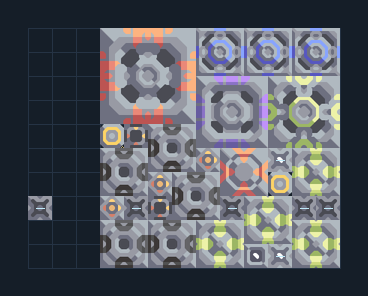

# ซิลิคอนจากทรายดำและน้ำ

**PROD-010** · 03 โรงงาน · 13×10 ช่อง · **ทดสอบระบบ**

เหมาะกับ: ขุดและผลิตในชุดเดียว  
รับ:   
ผลผลิต: ซิลิคอน  
วางเครื่องเจาะและตัวสกัดน้ำมันบนทรายดำ  
เครื่องสกัดน้ำวางบนพื้นดินที่สร้างได้; ตรวจน้ำจริงหลังเปิดโรงงานและอย่าแบ่งน้ำไปโหลดอื่นจนขาด  
ตัวสกัดน้ำมันต้องทับหินดินดานหรือทรายดำที่มีค่าผลิตน้ำมัน; พื้นหินทั่วไปให้ผลผลิตเป็นศูนย์  
โอเวอร์ไดรฟ์เพิ่มความต้องการทรัพยากร น้ำ และไฟฟ้า; เริ่มโดยปิดโอเวอร์ไดรฟ์จนแหล่งป้อนเพียงพอ  
จุดต่อเมื่อยังไม่หมุน: พิกัดเริ่ม 0 จากซ้ายล่าง  
ซิลิคอน ออก @ 0,2  
ไฟฟ้า @ 10,3  
ต่อผลผลิตเข้าคลังหรือโรงงานถัดไป เพื่อไม่ให้เครื่องหยุดเพราะทางออกเต็ม  
ผู้สร้างต้นฉบับ: anchovy8836 / Design-It (MIT)  
ปรับภาษาไทยและช่องต่อสำหรับชุดนี้  
ตรวจโครงสร้างและการตั้งค่า; อัตราผลิตต้องดูผลทดสอบจริงของแต่ละแบบ  
  
ผลทดสอบ Build 160.7: silicon 11.18/วินาที เมื่อป้อนวัตถุดิบที่จุดต่อและมีไฟครบ  
  
หมวด: 03 โรงงาน • Serpulo ไทย 2.0

**วัสดุก่อสร้าง:** ทองแดง 528 · กราไฟต์ 467 · ตะกั่ว 596 · เมตากลาส 108 · พลาสตาเนียม 30 · ซิลิคอน 330 · ทอเรียม 190 · ไทเทเนียม 300

[ดาวน์โหลด .msch](../../schematics/PROD-010.msch) · [รหัสนำเข้าจากคลิปบอร์ด](../../codes/PROD-010.txt) · [กลับสารบัญ](../INDEX.md)

ภาพประกอบใช้กราฟิกบล็อกจากตัวเกม ไม่ใช่ภาพการรบระหว่างเล่นจริง ทางป้อนต้องจ่ายวัตถุดิบและไฟตามเงื่อนไขที่ระบุ
