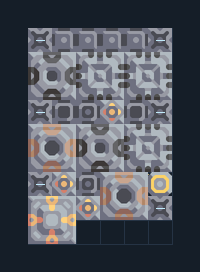

# ชุดวัสดุสามชนิด ติดแกนฐาน

**PROD-011** · 03 โรงงาน · 6×9 ช่อง · **ทดสอบระบบ**

เหมาะกับ: ติดแกนฐาน  
รับ: ตะกั่ว, ถ่านหิน, ทราย  
ผลผลิต: ซิลิคอน เมตากลาส และกราไฟต์ (แยกทางออก)  
วางแกนฐานหรือคลังขนาด 3×3 ที่จุดกลาง 3,-1 ก่อนวางผัง; ทรัพยากรที่ตั้งไว้ในตัวถอดต้องมีอยู่ในคลัง  
จุดต่อเมื่อยังไม่หมุน: พิกัดเริ่ม 0 จากซ้ายล่าง  
ไฟฟ้า @ 5,2  
ต่อผลผลิตเข้าคลังหรือโรงงานถัดไป เพื่อไม่ให้เครื่องหยุดเพราะทางออกเต็ม  
ผู้สร้างต้นฉบับ: justacommonegg / Design-It (MIT)  
ปรับภาษาไทยและช่องต่อสำหรับชุดนี้  
ตรวจโครงสร้างและการตั้งค่า; อัตราผลิตต้องดูผลทดสอบจริงของแต่ละแบบ  
  
ผลทดสอบ Build 160.7: graphite 1.88/วินาที; metaglass 4.00/วินาที; silicon 3.00/วินาที เมื่อป้อนวัตถุดิบที่จุดต่อและมีไฟครบ  
  
หมวด: 03 โรงงาน • Serpulo ไทย 2.0

**วัสดุก่อสร้าง:** ทองแดง 467 · กราไฟต์ 60 · ตะกั่ว 250 · ซิลิคอน 90 · ไทเทเนียม 175

[ดาวน์โหลด .msch](../../schematics/PROD-011.msch) · [รหัสนำเข้าจากคลิปบอร์ด](../../codes/PROD-011.txt) · [กลับสารบัญ](../INDEX.md)

ภาพประกอบใช้กราฟิกบล็อกจากตัวเกม ไม่ใช่ภาพการรบระหว่างเล่นจริง ทางป้อนต้องจ่ายวัตถุดิบและไฟตามเงื่อนไขที่ระบุ
