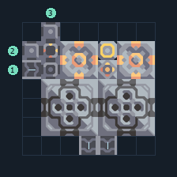

# ซิลิคอนเบ้าหลอม 2 เครื่อง พร้อมเชื้อเพลิง

**PROD-012** · 03 โรงงาน · 7×7 ช่อง · **ทดสอบระบบ**

เหมาะกับ: ป้อนจากสายพาน  
รับ: ตะกั่ว, ถ่านหิน, ทราย  
ผลผลิต: ซิลิคอน  
จุดต่อเมื่อยังไม่หมุน: พิกัดเริ่ม 0 จากซ้ายล่าง  
ถ่านหิน เข้า @ 0,4  
ทราย เข้า @ 0,5  
ตะกั่ว เข้า @ 1,6  
ผลผลิตออก @ 3,0  
ผลผลิตออก @ 4,0  
ไฟฟ้า @ 4,5  
ต่อผลผลิตเข้าคลังหรือโรงงานถัดไป เพื่อไม่ให้เครื่องหยุดเพราะทางออกเต็ม  
ผู้สร้างต้นฉบับ: y0. / Design-It (MIT)  
ปรับภาษาไทยและช่องต่อสำหรับชุดนี้  
ตรวจโครงสร้างและการตั้งค่า; อัตราผลิตต้องดูผลทดสอบจริงของแต่ละแบบ  
  
ผลทดสอบ Build 160.7: silicon 7.02/วินาที เมื่อป้อนวัตถุดิบที่จุดต่อและมีไฟครบ  
  
หมวด: 03 โรงงาน • Serpulo ไทย 2.0

**วัสดุก่อสร้าง:** ทองแดง 117 · ตะกั่ว 60 · เมตากลาส 160 · พลาสตาเนียม 70 · ซิลิคอน 150 · ไทเทเนียม 265

[ดาวน์โหลด .msch](../../schematics/PROD-012.msch) · [รหัสนำเข้าจากคลิปบอร์ด](../../codes/PROD-012.txt) · [กลับสารบัญ](../INDEX.md)

ภาพประกอบใช้กราฟิกบล็อกจากตัวเกม ไม่ใช่ภาพการรบระหว่างเล่นจริง ทางป้อนต้องจ่ายวัตถุดิบและไฟตามเงื่อนไขที่ระบุ
