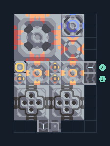

# ซิลิคอนเบ้าหลอมบนทราย 2 เครื่อง

**PROD-014** · 03 โรงงาน · 7×10 ช่อง · **ทดสอบระบบ**

เหมาะกับ: ขุดและผลิตในชุดเดียว  
รับ: ตะกั่ว, ถ่านหิน  
ผลผลิต: ซิลิคอน  
วางเครื่องเจาะบนทรายที่เจาะได้ และป้อนตะกั่วกับถ่านหินเข้าช่องที่ระบุ  
เครื่องสกัดน้ำวางบนพื้นดินที่สร้างได้; ตรวจน้ำจริงหลังเปิดโรงงานและอย่าแบ่งน้ำไปโหลดอื่นจนขาด  
โอเวอร์ไดรฟ์เพิ่มความต้องการทรัพยากร น้ำ และไฟฟ้า; เริ่มโดยปิดโอเวอร์ไดรฟ์จนแหล่งป้อนเพียงพอ  
จุดต่อเมื่อยังไม่หมุน: พิกัดเริ่ม 0 จากซ้ายล่าง  
ผลผลิตออก @ 2,0  
ถ่านหิน เข้า @ 6,4  
ตะกั่ว เข้า @ 6,5  
ไฟฟ้า @ 0,5  
ต่อผลผลิตเข้าคลังหรือโรงงานถัดไป เพื่อไม่ให้เครื่องหยุดเพราะทางออกเต็ม  
ผู้สร้างต้นฉบับ: justacommonegg / Design-It (MIT)  
ปรับภาษาไทยและช่องต่อสำหรับชุดนี้  
ตรวจโครงสร้างและการตั้งค่า; อัตราผลิตต้องดูผลทดสอบจริงของแต่ละแบบ  
  
ผลทดสอบ Build 160.7: silicon 7.38/วินาที เมื่อป้อนวัตถุดิบที่จุดต่อและมีไฟครบ  
  
หมวด: 03 โรงงาน • Serpulo ไทย 2.0

**วัสดุก่อสร้าง:** ทองแดง 203 · กราไฟต์ 30 · ตะกั่ว 186 · เมตากลาส 190 · พลาสตาเนียม 100 · ซิลิคอน 345 · ทอเรียม 75 · ไทเทเนียม 440

[ดาวน์โหลด .msch](../../schematics/PROD-014.msch) · [รหัสนำเข้าจากคลิปบอร์ด](../../codes/PROD-014.txt) · [กลับสารบัญ](../INDEX.md)

ภาพประกอบใช้กราฟิกบล็อกจากตัวเกม ไม่ใช่ภาพการรบระหว่างเล่นจริง ทางป้อนต้องจ่ายวัตถุดิบและไฟตามเงื่อนไขที่ระบุ
