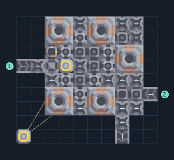

# เมตากลาสจากเศษวัสดุ 5 เตา

**PROD-016** · 03 โรงงาน · 10×9 ช่อง · **ทดสอบระบบ**

เหมาะกับ: แปรรูปเศษวัสดุ  
รับ: ตะกั่ว, เศษวัสดุ  
ผลผลิต: เมตากลาส  
จุดต่อเมื่อยังไม่หมุน: พิกัดเริ่ม 0 จากซ้ายล่าง  
เศษวัสดุ เข้า @ 0,5  
ผลผลิตออก @ 7,0  
ตะกั่ว เข้า @ 9,3  
ไฟฟ้า @ 0,0  
ต่อผลผลิตเข้าคลังหรือโรงงานถัดไป เพื่อไม่ให้เครื่องหยุดเพราะทางออกเต็ม  
ผู้สร้างต้นฉบับ: plent / Design-It (MIT)  
ปรับภาษาไทยและช่องต่อสำหรับชุดนี้  
ตรวจโครงสร้างและการตั้งค่า; อัตราผลิตต้องดูผลทดสอบจริงของแต่ละแบบ  
  
ผลทดสอบ Build 160.7: metaglass 4.93/วินาที เมื่อป้อนวัตถุดิบที่จุดต่อและมีไฟครบ  
  
หมวด: 03 โรงงาน • Serpulo ไทย 2.0

**วัสดุก่อสร้าง:** ทองแดง 632 · กราไฟต์ 150 · ตะกั่ว 437

[ดาวน์โหลด .msch](../../schematics/PROD-016.msch) · [รหัสนำเข้าจากคลิปบอร์ด](../../codes/PROD-016.txt) · [กลับสารบัญ](../INDEX.md)

ภาพประกอบใช้กราฟิกบล็อกจากตัวเกม ไม่ใช่ภาพการรบระหว่างเล่นจริง ทางป้อนต้องจ่ายวัตถุดิบและไฟตามเงื่อนไขที่ระบุ
