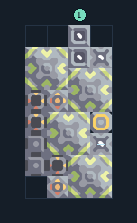

# พลาสตาเนียม 4 เครื่อง ติดแกนฐาน

**PROD-019** · 03 โรงงาน · 4×8 ช่อง · **ทดสอบระบบ**

เหมาะกับ: ติดแกนฐาน  
รับ: น้ำมัน, ไทเทเนียม  
ผลผลิต: พลาสตาเนียม  
วางแกนฐานหรือคลังขนาด 3×3 ที่จุดกลาง -1,-1 ก่อนวางผัง; ทรัพยากรที่ตั้งไว้ในตัวถอดต้องมีอยู่ในคลัง  
จุดต่อเมื่อยังไม่หมุน: พิกัดเริ่ม 0 จากซ้ายล่าง  
น้ำมัน เข้า @ 2,7  
ไฟฟ้า @ 3,3  
ต่อผลผลิตเข้าคลังหรือโรงงานถัดไป เพื่อไม่ให้เครื่องหยุดเพราะทางออกเต็ม  
ผู้สร้างต้นฉบับ: susernaeme / Design-It (MIT)  
ปรับภาษาไทยและช่องต่อสำหรับชุดนี้  
ตรวจโครงสร้างและการตั้งค่า; อัตราผลิตต้องดูผลทดสอบจริงของแต่ละแบบ  
  
ผลทดสอบ Build 160.7: plastanium 4.00/วินาที เมื่อป้อนวัตถุดิบที่จุดต่อและมีไฟครบ  
  
หมวด: 03 โรงงาน • Serpulo ไทย 2.0

**วัสดุก่อสร้าง:** ทองแดง 14 · กราไฟต์ 256 · ตะกั่ว 472 · เมตากลาส 20 · ซิลิคอน 380 · ไทเทเนียม 370

[ดาวน์โหลด .msch](../../schematics/PROD-019.msch) · [รหัสนำเข้าจากคลิปบอร์ด](../../codes/PROD-019.txt) · [กลับสารบัญ](../INDEX.md)

ภาพประกอบใช้กราฟิกบล็อกจากตัวเกม ไม่ใช่ภาพการรบระหว่างเล่นจริง ทางป้อนต้องจ่ายวัตถุดิบและไฟตามเงื่อนไขที่ระบุ
