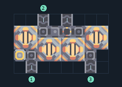

# ผ้าเฟส 4 เครื่อง รับทรายและทอเรียม

**PROD-021** · 03 โรงงาน · 8×5 ช่อง · **ทดสอบระบบ**

เหมาะกับ: ป้อนจากสายพาน  
รับ: ทราย, ทอเรียม  
ผลผลิต: ผ้าเฟส  
จุดต่อเมื่อยังไม่หมุน: พิกัดเริ่ม 0 จากซ้ายล่าง  
ทราย เข้า @ 1,0  
ทอเรียม เข้า @ 2,4  
ผลผลิตออก @ 4,4  
ทราย เข้า @ 6,0  
ไฟฟ้า @ 0,1  
ต่อผลผลิตเข้าคลังหรือโรงงานถัดไป เพื่อไม่ให้เครื่องหยุดเพราะทางออกเต็ม  
ผู้สร้างต้นฉบับ: y0. / Design-It (MIT)  
ปรับภาษาไทยและช่องต่อสำหรับชุดนี้  
ตรวจโครงสร้างและการตั้งค่า; อัตราผลิตต้องดูผลทดสอบจริงของแต่ละแบบ  
  
ผลทดสอบ Build 160.7: phase-fabric 1.02/วินาที เมื่อป้อนวัตถุดิบที่จุดต่อและมีไฟครบ  
  
หมวด: 03 โรงงาน • Serpulo ไทย 2.0

**วัสดุก่อสร้าง:** ทองแดง 27 · ตะกั่ว 496 · ซิลิคอน 520 · ทอเรียม 300

[ดาวน์โหลด .msch](../../schematics/PROD-021.msch) · [รหัสนำเข้าจากคลิปบอร์ด](../../codes/PROD-021.txt) · [กลับสารบัญ](../INDEX.md)

ภาพประกอบใช้กราฟิกบล็อกจากตัวเกม ไม่ใช่ภาพการรบระหว่างเล่นจริง ทางป้อนต้องจ่ายวัตถุดิบและไฟตามเงื่อนไขที่ระบุ
