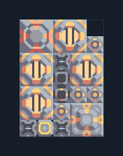

# ผ้าเฟส 4 เครื่อง ติดแกนฐาน

**PROD-022** · 03 โรงงาน · 5×7 ช่อง · **ทดสอบระบบ**

เหมาะกับ: ติดแกนฐาน  
รับ: ทราย, ทอเรียม  
ผลผลิต: ผ้าเฟส  
วางแกนฐานหรือคลังขนาด 4×4 ที่จุดกลาง 6,3 ก่อนวางผัง; ทรัพยากรที่ตั้งไว้ในตัวถอดต้องมีอยู่ในคลัง  
โอเวอร์ไดรฟ์เพิ่มความต้องการทรัพยากร น้ำ และไฟฟ้า; เริ่มโดยปิดโอเวอร์ไดรฟ์จนแหล่งป้อนเพียงพอ  
จุดต่อเมื่อยังไม่หมุน: พิกัดเริ่ม 0 จากซ้ายล่าง  
ไฟฟ้า @ 1,0  
ต่อผลผลิตเข้าคลังหรือโรงงานถัดไป เพื่อไม่ให้เครื่องหยุดเพราะทางออกเต็ม  
ผู้สร้างต้นฉบับ: justacommonegg / Design-It (MIT)  
ปรับภาษาไทยและช่องต่อสำหรับชุดนี้  
ตรวจโครงสร้างและการตั้งค่า; อัตราผลิตต้องดูผลทดสอบจริงของแต่ละแบบ  
  
ผลทดสอบ Build 160.7: phase-fabric 0.55/วินาที เมื่อป้อนวัตถุดิบที่จุดต่อและมีไฟครบ  
  
หมวด: 03 โรงงาน • Serpulo ไทย 2.0

**วัสดุก่อสร้าง:** ทองแดง 24 · ตะกั่ว 608 · พลาสตาเนียม 30 · ซิลิคอน 715 · ทอเรียม 300 · ไทเทเนียม 275

[ดาวน์โหลด .msch](../../schematics/PROD-022.msch) · [รหัสนำเข้าจากคลิปบอร์ด](../../codes/PROD-022.txt) · [กลับสารบัญ](../INDEX.md)

ภาพประกอบใช้กราฟิกบล็อกจากตัวเกม ไม่ใช่ภาพการรบระหว่างเล่นจริง ทางป้อนต้องจ่ายวัตถุดิบและไฟตามเงื่อนไขที่ระบุ
