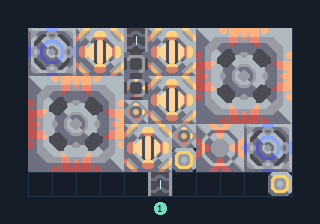

# ผ้าเฟส 4 เครื่อง ขุดทรายในชุด

**PROD-023** · 03 โรงงาน · 11×7 ช่อง · **ทดสอบระบบ**

เหมาะกับ: ขุดและผลิตในชุดเดียว  
รับ: ทอเรียม  
ผลผลิต: ผ้าเฟส  
วางเครื่องเจาะบนทราย; ป้อนทอเรียมจากภายนอก  
เครื่องสกัดน้ำวางบนพื้นดินที่สร้างได้; ตรวจน้ำจริงหลังเปิดโรงงานและอย่าแบ่งน้ำไปโหลดอื่นจนขาด  
โอเวอร์ไดรฟ์เพิ่มความต้องการทรัพยากร น้ำ และไฟฟ้า; เริ่มโดยปิดโอเวอร์ไดรฟ์จนแหล่งป้อนเพียงพอ  
จุดต่อเมื่อยังไม่หมุน: พิกัดเริ่ม 0 จากซ้ายล่าง  
ผลผลิตออก @ 4,6  
ทอเรียม เข้า @ 5,0  
ไฟฟ้า @ 10,0  
ต่อผลผลิตเข้าคลังหรือโรงงานถัดไป เพื่อไม่ให้เครื่องหยุดเพราะทางออกเต็ม  
ผู้สร้างต้นฉบับ: xnuuizh / Design-It (MIT)  
ปรับภาษาไทยและช่องต่อสำหรับชุดนี้  
ตรวจโครงสร้างและการตั้งค่า; อัตราผลิตต้องดูผลทดสอบจริงของแต่ละแบบ  
  
ผลทดสอบ Build 160.7: phase-fabric 1.97/วินาที เมื่อป้อนวัตถุดิบที่จุดต่อและมีไฟครบ  
  
หมวด: 03 โรงงาน • Serpulo ไทย 2.0

**วัสดุก่อสร้าง:** ทองแดง 200 · กราไฟต์ 60 · ตะกั่ว 656 · เมตากลาส 60 · พลาสตาเนียม 30 · ซิลิคอน 775 · ทอเรียม 450 · ไทเทเนียม 225

[ดาวน์โหลด .msch](../../schematics/PROD-023.msch) · [รหัสนำเข้าจากคลิปบอร์ด](../../codes/PROD-023.txt) · [กลับสารบัญ](../INDEX.md)

ภาพประกอบใช้กราฟิกบล็อกจากตัวเกม ไม่ใช่ภาพการรบระหว่างเล่นจริง ทางป้อนต้องจ่ายวัตถุดิบและไฟตามเงื่อนไขที่ระบุ
