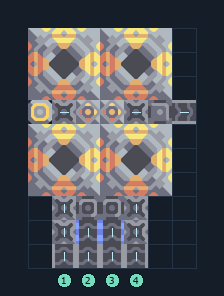

# เซิร์จอัลลอย 4 เครื่อง แยกสายป้อน

**PROD-024** · 03 โรงงาน · 7×10 ช่อง · **ทดสอบระบบ**

เหมาะกับ: ป้อนจากสายพาน  
รับ: ซิลิคอน, ตะกั่ว, ทองแดง, ไทเทเนียม  
ผลผลิต: เซิร์จอัลลอย  
จุดต่อเมื่อยังไม่หมุน: พิกัดเริ่ม 0 จากซ้ายล่าง  
ทองแดง เข้า @ 1,0  
ซิลิคอน เข้า @ 2,0  
ไทเทเนียม เข้า @ 3,0  
ตะกั่ว เข้า @ 4,0  
ผลผลิตออก @ 6,6  
ไฟฟ้า @ 0,6  
ต่อผลผลิตเข้าคลังหรือโรงงานถัดไป เพื่อไม่ให้เครื่องหยุดเพราะทางออกเต็ม  
ผู้สร้างต้นฉบับ: justacommonegg / Design-It (MIT)  
ปรับภาษาไทยและช่องต่อสำหรับชุดนี้  
ตรวจโครงสร้างและการตั้งค่า; อัตราผลิตต้องดูผลทดสอบจริงของแต่ละแบบ  
  
ผลทดสอบ Build 160.7: surge-alloy 1.27/วินาที เมื่อป้อนวัตถุดิบที่จุดต่อและมีไฟครบ  
  
หมวด: 03 โรงงาน • Serpulo ไทย 2.0

**วัสดุก่อสร้าง:** ทองแดง 56 · ตะกั่ว 368 · ซิลิคอน 380 · ทอเรียม 280 · ไทเทเนียม 52

[ดาวน์โหลด .msch](../../schematics/PROD-024.msch) · [รหัสนำเข้าจากคลิปบอร์ด](../../codes/PROD-024.txt) · [กลับสารบัญ](../INDEX.md)

ภาพประกอบใช้กราฟิกบล็อกจากตัวเกม ไม่ใช่ภาพการรบระหว่างเล่นจริง ทางป้อนต้องจ่ายวัตถุดิบและไฟตามเงื่อนไขที่ระบุ
