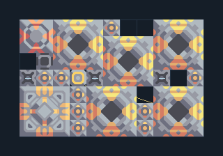

# เซิร์จอัลลอย 5 เครื่อง ติดแกนฐาน

**PROD-025** · 03 โรงงาน · 11×7 ช่อง · **ทดสอบระบบ**

เหมาะกับ: ติดแกนฐาน  
รับ: ซิลิคอน, ตะกั่ว, ทองแดง, ไทเทเนียม  
ผลผลิต: เซิร์จอัลลอย  
วางแกนฐานหรือคลังขนาด 5×5 ที่จุดกลาง 5,-3 ก่อนวางผัง; ทรัพยากรที่ตั้งไว้ในตัวถอดต้องมีอยู่ในคลัง  
โอเวอร์ไดรฟ์เพิ่มความต้องการทรัพยากร น้ำ และไฟฟ้า; เริ่มโดยปิดโอเวอร์ไดรฟ์จนแหล่งป้อนเพียงพอ  
จุดต่อเมื่อยังไม่หมุน: พิกัดเริ่ม 0 จากซ้ายล่าง  
ไฟฟ้า @ 3,3  
ต่อผลผลิตเข้าคลังหรือโรงงานถัดไป เพื่อไม่ให้เครื่องหยุดเพราะทางออกเต็ม  
ผู้สร้างต้นฉบับ: justacommonegg / Design-It (MIT)  
ปรับภาษาไทยและช่องต่อสำหรับชุดนี้  
ตรวจโครงสร้างและการตั้งค่า; อัตราผลิตต้องดูผลทดสอบจริงของแต่ละแบบ  
  
ผลทดสอบ Build 160.7: surge-alloy 0.52/วินาที เมื่อป้อนวัตถุดิบที่จุดต่อและมีไฟครบ  
  
หมวด: 03 โรงงาน • Serpulo ไทย 2.0

**วัสดุก่อสร้าง:** ทองแดง 22 · ตะกั่ว 526 · พลาสตาเนียม 30 · ซิลิคอน 745 · ทอเรียม 475 · ไทเทเนียม 550

[ดาวน์โหลด .msch](../../schematics/PROD-025.msch) · [รหัสนำเข้าจากคลิปบอร์ด](../../codes/PROD-025.txt) · [กลับสารบัญ](../INDEX.md)

ภาพประกอบใช้กราฟิกบล็อกจากตัวเกม ไม่ใช่ภาพการรบระหว่างเล่นจริง ทางป้อนต้องจ่ายวัตถุดิบและไฟตามเงื่อนไขที่ระบุ
