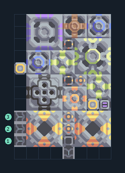

# เซิร์จอัลลอยจากทรายดำ พร้อมซิลิคอน

**PROD-026** · 03 โรงงาน · 8×12 ช่อง · **ทดสอบระบบ**

เหมาะกับ: ขุดและผลิตในชุดเดียว  
รับ: ตะกั่ว, ทองแดง, ไทเทเนียม  
ผลผลิต: เซิร์จอัลลอย  
วางเครื่องเจาะและตัวสกัดน้ำมันบนทรายดำ; ป้อนทองแดง ตะกั่ว และไทเทเนียม  
เครื่องสกัดน้ำวางบนพื้นดินที่สร้างได้; ตรวจน้ำจริงหลังเปิดโรงงานและอย่าแบ่งน้ำไปโหลดอื่นจนขาด  
ตัวสกัดน้ำมันต้องทับหินดินดานหรือทรายดำที่มีค่าผลิตน้ำมัน; พื้นหินทั่วไปให้ผลผลิตเป็นศูนย์  
จุดต่อเมื่อยังไม่หมุน: พิกัดเริ่ม 0 จากซ้ายล่าง  
ไทเทเนียม เข้า @ 0,1  
ตะกั่ว เข้า @ 0,2  
ทองแดง เข้า @ 0,3  
ผลผลิตออก @ 4,0  
ไฟฟ้า @ 0,7  
ต่อผลผลิตเข้าคลังหรือโรงงานถัดไป เพื่อไม่ให้เครื่องหยุดเพราะทางออกเต็ม  
ผู้สร้างต้นฉบับ: justacommonegg / Design-It (MIT)  
ปรับภาษาไทยและช่องต่อสำหรับชุดนี้  
ตรวจโครงสร้างและการตั้งค่า; อัตราผลิตต้องดูผลทดสอบจริงของแต่ละแบบ  
  
ผลทดสอบ Build 160.7: surge-alloy 0.97/วินาที เมื่อป้อนวัตถุดิบที่จุดต่อและมีไฟครบ  
  
หมวด: 03 โรงงาน • Serpulo ไทย 2.0

**วัสดุก่อสร้าง:** ทองแดง 326 · กราไฟต์ 350 · ตะกั่ว 438 · เมตากลาส 140 · พลาสตาเนียม 35 · ซิลิคอน 415 · ทอเรียม 255 · ไทเทเนียม 255

[ดาวน์โหลด .msch](../../schematics/PROD-026.msch) · [รหัสนำเข้าจากคลิปบอร์ด](../../codes/PROD-026.txt) · [กลับสารบัญ](../INDEX.md)

ภาพประกอบใช้กราฟิกบล็อกจากตัวเกม ไม่ใช่ภาพการรบระหว่างเล่นจริง ทางป้อนต้องจ่ายวัตถุดิบและไฟตามเงื่อนไขที่ระบุ
