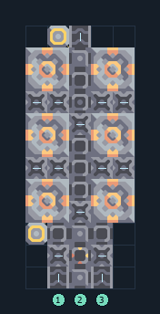

# ไพราไทต์ 6 เครื่อง วัสดุสร้างขั้นต้น

**PROD-027** · 03 โรงงาน · 5×12 ช่อง · **ทดสอบระบบ**

เหมาะกับ: ป้อนจากสายพาน  
รับ: ตะกั่ว, ถ่านหิน, ทราย  
ผลผลิต: ไพราไทต์  
จุดต่อเมื่อยังไม่หมุน: พิกัดเริ่ม 0 จากซ้ายล่าง  
ตะกั่ว เข้า @ 1,0  
ถ่านหิน เข้า @ 2,0  
ผลผลิตออก @ 2,11  
ทราย เข้า @ 3,0  
ไฟฟ้า @ 0,2  
ต่อผลผลิตเข้าคลังหรือโรงงานถัดไป เพื่อไม่ให้เครื่องหยุดเพราะทางออกเต็ม  
ผู้สร้างต้นฉบับ: justacommonegg / Design-It (MIT)  
ปรับภาษาไทยและช่องต่อสำหรับชุดนี้  
ตรวจโครงสร้างและการตั้งค่า; อัตราผลิตต้องดูผลทดสอบจริงของแต่ละแบบ  
  
ผลทดสอบ Build 160.7: pyratite 2.47/วินาที เมื่อป้อนวัตถุดิบที่จุดต่อและมีไฟครบ  
  
หมวด: 03 โรงงาน • Serpulo ไทย 2.0

**วัสดุก่อสร้าง:** ทองแดง 406 · ตะกั่ว 250

[ดาวน์โหลด .msch](../../schematics/PROD-027.msch) · [รหัสนำเข้าจากคลิปบอร์ด](../../codes/PROD-027.txt) · [กลับสารบัญ](../INDEX.md)

ภาพประกอบใช้กราฟิกบล็อกจากตัวเกม ไม่ใช่ภาพการรบระหว่างเล่นจริง ทางป้อนต้องจ่ายวัตถุดิบและไฟตามเงื่อนไขที่ระบุ
