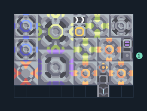

# ไพราไทต์จากทราย พร้อมผลิตถ่านหิน

**PROD-029** · 03 โรงงาน · 10×7 ช่อง · **ทดสอบระบบ**

เหมาะกับ: ขุดและผลิตในชุดเดียว  
รับ: ตะกั่ว  
ผลผลิต: ไพราไทต์  
วางเครื่องเจาะบนทราย ส่วนตัวสกัดน้ำมันต้องทับพื้นดินที่มีค่าน้ำมัน; ป้อนตะกั่วภายนอก  
เครื่องสกัดน้ำวางบนพื้นดินที่สร้างได้; ตรวจน้ำจริงหลังเปิดโรงงานและอย่าแบ่งน้ำไปโหลดอื่นจนขาด  
ตัวสกัดน้ำมันต้องทับหินดินดานหรือทรายดำที่มีค่าผลิตน้ำมัน; พื้นหินทั่วไปให้ผลผลิตเป็นศูนย์  
โอเวอร์ไดรฟ์เพิ่มความต้องการทรัพยากร น้ำ และไฟฟ้า; เริ่มโดยปิดโอเวอร์ไดรฟ์จนแหล่งป้อนเพียงพอ  
จุดต่อเมื่อยังไม่หมุน: พิกัดเริ่ม 0 จากซ้ายล่าง  
ผลผลิตออก @ 7,0  
ตะกั่ว เข้า @ 9,3  
ไฟฟ้า @ 5,5  
ต่อผลผลิตเข้าคลังหรือโรงงานถัดไป เพื่อไม่ให้เครื่องหยุดเพราะทางออกเต็ม  
ผู้สร้างต้นฉบับ: anchovy8836 / Design-It (MIT)  
ปรับภาษาไทยและช่องต่อสำหรับชุดนี้  
ตรวจโครงสร้างและการตั้งค่า; อัตราผลิตต้องดูผลทดสอบจริงของแต่ละแบบ  
  
ผลทดสอบ Build 160.7: pyratite 3.20/วินาที เมื่อป้อนวัตถุดิบที่จุดต่อและมีไฟครบ  
  
หมวด: 03 โรงงาน • Serpulo ไทย 2.0

**วัสดุก่อสร้าง:** ทองแดง 426 · กราไฟต์ 360 · ตะกั่ว 418 · เมตากลาส 61 · พลาสตาเนียม 30 · ซิลิคอน 210 · ทอเรียม 115 · ไทเทเนียม 160

[ดาวน์โหลด .msch](../../schematics/PROD-029.msch) · [รหัสนำเข้าจากคลิปบอร์ด](../../codes/PROD-029.txt) · [กลับสารบัญ](../INDEX.md)

ภาพประกอบใช้กราฟิกบล็อกจากตัวเกม ไม่ใช่ภาพการรบระหว่างเล่นจริง ทางป้อนต้องจ่ายวัตถุดิบและไฟตามเงื่อนไขที่ระบุ
