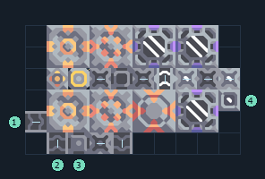

# สารระเบิด 2 เครื่อง พร้อมไพราไทต์และสปอร์

**PROD-030** · 03 โรงงาน · 10×6 ช่อง · **ทดสอบระบบ**

เหมาะกับ: ป้อนจากสายพานและน้ำ  
รับ: ตะกั่ว, ถ่านหิน, ทราย, น้ำ  
ผลผลิต: สารระเบิด  
เครื่องเพาะสปอร์ใช้ไฟฟ้าและน้ำอย่างต่อเนื่อง; พื้นสปอร์เพิ่มผลผลิต แต่ไม่แทนการจ่ายน้ำ  
โอเวอร์ไดรฟ์เพิ่มความต้องการทรัพยากร น้ำ และไฟฟ้า; เริ่มโดยปิดโอเวอร์ไดรฟ์จนแหล่งป้อนเพียงพอ  
จุดต่อเมื่อยังไม่หมุน: พิกัดเริ่ม 0 จากซ้ายล่าง  
ตะกั่ว เข้า @ 0,1  
ทราย เข้า @ 1,0  
ถ่านหิน เข้า @ 2,0  
ผลผลิตออก @ 4,0  
น้ำ เข้า @ 9,2  
ไฟฟ้า @ 2,3  
ต่อผลผลิตเข้าคลังหรือโรงงานถัดไป เพื่อไม่ให้เครื่องหยุดเพราะทางออกเต็ม  
ผู้สร้างต้นฉบับ: xnuuizh / Design-It (MIT)  
ปรับภาษาไทยและช่องต่อสำหรับชุดนี้  
ตรวจโครงสร้างและการตั้งค่า; อัตราผลิตต้องดูผลทดสอบจริงของแต่ละแบบ  
  
ผลทดสอบ Build 160.7: blast-compound 2.23/วินาที เมื่อป้อนวัตถุดิบที่จุดต่อและมีไฟครบ  
  
หมวด: 03 โรงงาน • Serpulo ไทย 2.0

**วัสดุก่อสร้าง:** ทองแดง 209 · กราไฟต์ 12 · ตะกั่ว 317 · เมตากลาส 19 · พลาสตาเนียม 30 · ซิลิคอน 135 · ไทเทเนียม 140

[ดาวน์โหลด .msch](../../schematics/PROD-030.msch) · [รหัสนำเข้าจากคลิปบอร์ด](../../codes/PROD-030.txt) · [กลับสารบัญ](../INDEX.md)

ภาพประกอบใช้กราฟิกบล็อกจากตัวเกม ไม่ใช่ภาพการรบระหว่างเล่นจริง ทางป้อนต้องจ่ายวัตถุดิบและไฟตามเงื่อนไขที่ระบุ
