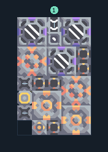

# สารระเบิด 2 เครื่อง ติดแกนฐาน

**PROD-031** · 03 โรงงาน · 5×8 ช่อง · **ทดสอบระบบ**

เหมาะกับ: ติดแกนฐาน  
รับ: ตะกั่ว, ถ่านหิน, ทราย, น้ำ  
ผลผลิต: สารระเบิด  
วางแกนฐานหรือคลังขนาด 3×3 ที่จุดกลาง -1,-1 ก่อนวางผัง; ทรัพยากรที่ตั้งไว้ในตัวถอดต้องมีอยู่ในคลัง  
เครื่องเพาะสปอร์ใช้ไฟฟ้าและน้ำอย่างต่อเนื่อง; พื้นสปอร์เพิ่มผลผลิต แต่ไม่แทนการจ่ายน้ำ  
จุดต่อเมื่อยังไม่หมุน: พิกัดเริ่ม 0 จากซ้ายล่าง  
น้ำ เข้า @ 2,7  
ไฟฟ้า @ 0,2  
ต่อผลผลิตเข้าคลังหรือโรงงานถัดไป เพื่อไม่ให้เครื่องหยุดเพราะทางออกเต็ม  
ผู้สร้างต้นฉบับ: ultimane / Design-It (MIT)  
ปรับภาษาไทยและช่องต่อสำหรับชุดนี้  
ตรวจโครงสร้างและการตั้งค่า; อัตราผลิตต้องดูผลทดสอบจริงของแต่ละแบบ  
  
ผลทดสอบ Build 160.7: blast-compound 1.50/วินาที เมื่อป้อนวัตถุดิบที่จุดต่อและมีไฟครบ  
  
หมวด: 03 โรงงาน • Serpulo ไทย 2.0

**วัสดุก่อสร้าง:** ทองแดง 199 · กราไฟต์ 4 · ตะกั่ว 213 · เมตากลาส 3 · ซิลิคอน 60 · ไทเทเนียม 65

[ดาวน์โหลด .msch](../../schematics/PROD-031.msch) · [รหัสนำเข้าจากคลิปบอร์ด](../../codes/PROD-031.txt) · [กลับสารบัญ](../INDEX.md)

ภาพประกอบใช้กราฟิกบล็อกจากตัวเกม ไม่ใช่ภาพการรบระหว่างเล่นจริง ทางป้อนต้องจ่ายวัตถุดิบและไฟตามเงื่อนไขที่ระบุ
