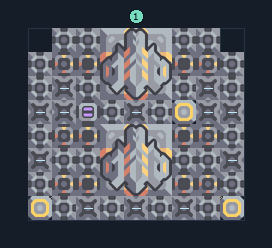

# บดเศษวัสดุ 24 เครื่อง รับและส่งเครื่องยิงมวล

**PROD-035** · 03 โรงงาน · 9×8 ช่อง · **ทดสอบระบบ**

เหมาะกับ: รับส่งผ่านเครื่องยิงมวล  
รับ: เศษวัสดุ  
ผลผลิต: ทราย  
ก่อนหมุน: ตั้งเครื่องยิงมวลต้นทางภายนอกให้ยิงเศษวัสดุมาที่ตัวรับ (4,6); ตั้งตัวส่งทรายในผัง (4,2) ให้ยิงไปตัวรับภายนอก แล้วต่อสายพานจากตัวรับนั้นเข้าคลัง; ทุกตัวต้องมีไฟและอยู่ในวงระยะที่เกมแสดง; ช่องป้อนตรงสำรองอยู่เหนือตัวรับที่ (4,8)  
เลือกเครื่องยิงมวลเพื่อเชื่อมคู่ส่งหรือรับภายนอกหลังวาง; เติมวัตถุดิบตามชนิดของโรงงานและต่อสายพานนำผลผลิตออก  
จุดต่อเมื่อยังไม่หมุน: พิกัดเริ่ม 0 จากซ้ายล่าง  
เศษวัสดุ เข้า @ 4,6  
เครื่องยิงมวล เชื่อมคู่ส่ง/รับ @ 4,2  
เครื่องยิงมวล เชื่อมคู่ส่ง/รับ @ 4,6  
ไฟฟ้า @ 0,0  
ต่อผลผลิตเข้าคลังหรือโรงงานถัดไป เพื่อไม่ให้เครื่องหยุดเพราะทางออกเต็ม  
ผู้สร้างต้นฉบับ: justacommonegg / Design-It (MIT)  
ปรับภาษาไทยและช่องต่อสำหรับชุดนี้  
ตรวจโครงสร้างและการตั้งค่า; อัตราผลิตต้องดูผลทดสอบจริงของแต่ละแบบ  
  
ผลทดสอบ Build 160.7: sand 3.00/วินาที เมื่อป้อนวัตถุดิบที่จุดต่อและมีไฟครบ  
  
หมวด: 03 โรงงาน • Serpulo ไทย 2.0

**วัสดุก่อสร้าง:** ทองแดง 839 · กราไฟต์ 5 · ตะกั่ว 964 · ซิลิคอน 150 · ทอเรียม 100 · ไทเทเนียม 250

[ดาวน์โหลด .msch](../../schematics/PROD-035.msch) · [รหัสนำเข้าจากคลิปบอร์ด](../../codes/PROD-035.txt) · [กลับสารบัญ](../INDEX.md)

ภาพประกอบใช้กราฟิกบล็อกจากตัวเกม ไม่ใช่ภาพการรบระหว่างเล่นจริง ทางป้อนต้องจ่ายวัตถุดิบและไฟตามเงื่อนไขที่ระบุ
