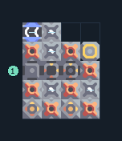

# หลอมเศษวัสดุเป็นสแลก 7 เครื่อง

**PROD-036** · 03 โรงงาน · 4×5 ช่อง · **ทดสอบระบบ**

เหมาะกับ: ป้อนจากสายพาน  
รับ: เศษวัสดุ  
ผลผลิต: สแลก  
จุดต่อเมื่อยังไม่หมุน: พิกัดเริ่ม 0 จากซ้ายล่าง  
เศษวัสดุ เข้า @ 0,2  
ของเหลวออก @ 0,4  
ไฟฟ้า @ 3,3  
ต่อผลผลิตเข้าคลังหรือโรงงานถัดไป เพื่อไม่ให้เครื่องหยุดเพราะทางออกเต็ม  
ผู้สร้างต้นฉบับ: araneoplasticnoob / Design-It (MIT)  
ปรับภาษาไทยและช่องต่อสำหรับชุดนี้  
ตรวจโครงสร้างและการตั้งค่า; อัตราผลิตต้องดูผลทดสอบจริงของแต่ละแบบ  
  
ผลทดสอบ Build 160.7: slag 36.00/วินาที เมื่อป้อนวัตถุดิบที่จุดต่อและมีไฟครบ  
  
หมวด: 03 โรงงาน • Serpulo ไทย 2.0

**วัสดุก่อสร้าง:** ทองแดง 221 · กราไฟต์ 331 · ตะกั่ว 255 · เมตากลาส 33 · ซิลิคอน 60 · ไทเทเนียม 52

[ดาวน์โหลด .msch](../../schematics/PROD-036.msch) · [รหัสนำเข้าจากคลิปบอร์ด](../../codes/PROD-036.txt) · [กลับสารบัญ](../INDEX.md)

ภาพประกอบใช้กราฟิกบล็อกจากตัวเกม ไม่ใช่ภาพการรบระหว่างเล่นจริง ทางป้อนต้องจ่ายวัตถุดิบและไฟตามเงื่อนไขที่ระบุ
