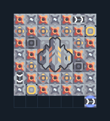

# หลอมเศษวัสดุ 17 เครื่อง รับผ่านเครื่องยิง

**PROD-037** · 03 โรงงาน · 7×8 ช่อง · **ทดสอบระบบ**

เหมาะกับ: รับผ่านเครื่องยิงมวล  
รับ: เศษวัสดุ  
ผลผลิต: สแลก  
ก่อนหมุน: ตั้งเครื่องยิงมวลต้นทางภายนอกให้ยิงเศษวัสดุมาที่ตัวรับ (3,4) ในผัง และต่อไฟทั้งต้นทางกับโรงงาน; รับสแลกจากท่อ (6,0) ทางด้านขวา (7,0); เครื่องยิงต้องอยู่ในวงระยะที่เกมแสดง  
เลือกเครื่องยิงมวลเพื่อเชื่อมคู่ส่งหรือรับภายนอกหลังวาง; เติมวัตถุดิบตามชนิดของโรงงานและต่อสายพานนำผลผลิตออก  
จุดต่อเมื่อยังไม่หมุน: พิกัดเริ่ม 0 จากซ้ายล่าง  
ของเหลวออก @ 6,0  
เครื่องยิงมวล เชื่อมคู่ส่ง/รับ @ 3,4  
ไฟฟ้า @ 6,6  
ต่อผลผลิตเข้าคลังหรือโรงงานถัดไป เพื่อไม่ให้เครื่องหยุดเพราะทางออกเต็ม  
ผู้สร้างต้นฉบับ: tudr / Design-It (MIT)  
ปรับภาษาไทยและช่องต่อสำหรับชุดนี้  
ตรวจโครงสร้างและการตั้งค่า; อัตราผลิตต้องดูผลทดสอบจริงของแต่ละแบบ  
  
ผลทดสอบ Build 160.7: slag 72.00/วินาที เมื่อป้อนวัตถุดิบที่จุดต่อและมีไฟครบ  
  
หมวด: 03 โรงงาน • Serpulo ไทย 2.0

**วัสดุก่อสร้าง:** ทองแดง 522 · กราไฟต์ 805 · ตะกั่ว 736 · เมตากลาส 83 · ซิลิคอน 285 · ทอเรียม 50 · ไทเทเนียม 302

[ดาวน์โหลด .msch](../../schematics/PROD-037.msch) · [รหัสนำเข้าจากคลิปบอร์ด](../../codes/PROD-037.txt) · [กลับสารบัญ](../INDEX.md)

ภาพประกอบใช้กราฟิกบล็อกจากตัวเกม ไม่ใช่ภาพการรบระหว่างเล่นจริง ทางป้อนต้องจ่ายวัตถุดิบและไฟตามเงื่อนไขที่ระบุ
