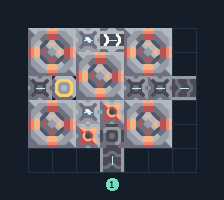

# แยกแร่ 5 เครื่อง พร้อมหลอมเศษวัสดุ

**PROD-038** · 03 โรงงาน · 7×6 ช่อง · **ทดสอบระบบ**

เหมาะกับ: แปรรูปเศษวัสดุ  
รับ: เศษวัสดุ  
ผลผลิต: ทองแดง ตะกั่ว กราไฟต์ ไทเทเนียม (ผลผลิตสุ่ม ต้องระบายทุกชนิด)  
จุดต่อเมื่อยังไม่หมุน: พิกัดเริ่ม 0 จากซ้ายล่าง  
เศษวัสดุ เข้า @ 3,0  
ผลผลิตออก @ 6,3  
ไฟฟ้า @ 1,3  
ต่อผลผลิตเข้าคลังหรือโรงงานถัดไป เพื่อไม่ให้เครื่องหยุดเพราะทางออกเต็ม  
ผู้สร้างต้นฉบับ: .stod / Design-It (MIT)  
ปรับภาษาไทยและช่องต่อสำหรับชุดนี้  
ตรวจโครงสร้างและการตั้งค่า; อัตราผลิตต้องดูผลทดสอบจริงของแต่ละแบบ  
  
ผลทดสอบ Build 160.7: copper 1.72/วินาที; graphite 0.68/วินาที; lead 1.20/วินาที; titanium 0.70/วินาที เมื่อป้อนวัตถุดิบที่จุดต่อและมีไฟครบ  
  
หมวด: 03 โรงงาน • Serpulo ไทย 2.0

**วัสดุก่อสร้าง:** ทองแดง 236 · กราไฟต์ 98 · ตะกั่ว 96 · เมตากลาส 17 · ไทเทเนียม 125

[ดาวน์โหลด .msch](../../schematics/PROD-038.msch) · [รหัสนำเข้าจากคลิปบอร์ด](../../codes/PROD-038.txt) · [กลับสารบัญ](../INDEX.md)

ภาพประกอบใช้กราฟิกบล็อกจากตัวเกม ไม่ใช่ภาพการรบระหว่างเล่นจริง ทางป้อนต้องจ่ายวัตถุดิบและไฟตามเงื่อนไขที่ระบุ
