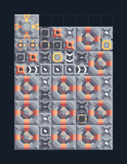

# แยกแร่ 11 เครื่อง ติดแกนฐาน

**PROD-039** · 03 โรงงาน · 8×11 ช่อง · **ทดสอบระบบ**

เหมาะกับ: ติดแกนฐาน  
รับ: เศษวัสดุ  
ผลผลิต: ทองแดง ตะกั่ว กราไฟต์ ไทเทเนียม (ผลผลิตสุ่ม ต้องระบายทุกชนิด)  
วางแกนฐานหรือคลังขนาด 3×3 ที่จุดกลาง 3,11 ก่อนวางผัง; ทรัพยากรที่ตั้งไว้ในตัวถอดต้องมีอยู่ในคลัง  
จุดต่อเมื่อยังไม่หมุน: พิกัดเริ่ม 0 จากซ้ายล่าง  
ไฟฟ้า @ 7,8  
ต่อผลผลิตเข้าคลังหรือโรงงานถัดไป เพื่อไม่ให้เครื่องหยุดเพราะทางออกเต็ม  
ผู้สร้างต้นฉบับ: justacommonegg / Design-It (MIT)  
ปรับภาษาไทยและช่องต่อสำหรับชุดนี้  
ตรวจโครงสร้างและการตั้งค่า; อัตราผลิตต้องดูผลทดสอบจริงของแต่ละแบบ  
  
ผลทดสอบ Build 160.7: copper 8.08/วินาที; graphite 3.12/วินาที; lead 4.63/วินาที; titanium 3.03/วินาที เมื่อป้อนวัตถุดิบที่จุดต่อและมีไฟครบ  
  
หมวด: 03 โรงงาน • Serpulo ไทย 2.0

**วัสดุก่อสร้าง:** ทองแดง 504 · กราไฟต์ 228 · ตะกั่ว 198 · เมตากลาส 75 · ซิลิคอน 60 · ไทเทเนียม 425

[ดาวน์โหลด .msch](../../schematics/PROD-039.msch) · [รหัสนำเข้าจากคลิปบอร์ด](../../codes/PROD-039.txt) · [กลับสารบัญ](../INDEX.md)

ภาพประกอบใช้กราฟิกบล็อกจากตัวเกม ไม่ใช่ภาพการรบระหว่างเล่นจริง ทางป้อนต้องจ่ายวัตถุดิบและไฟตามเงื่อนไขที่ระบุ
