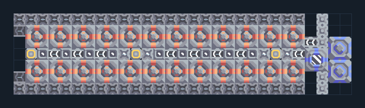

# แยกแร่ 24 เครื่อง สูบสแลกจากแผนที่

**PROD-040** · 03 โรงงาน · 29×7 ช่อง · **ทดสอบระบบ**

เหมาะกับ: ใช้แอ่งสแลก  
รับ:   
ผลผลิต: ทองแดง ตะกั่ว กราไฟต์ ไทเทเนียม (ผลผลิตสุ่ม ต้องระบายทุกชนิด)  
ปั๊มทั้งสองเครื่องต้องจมเต็มพื้นที่ในสแลกชนิดเดียวกัน; เครื่องแยกแร่วางบนฝั่ง  
จุดต่อเมื่อยังไม่หมุน: พิกัดเริ่ม 0 จากซ้ายล่าง  
ผลผลิตออก @ 0,1  
ผลผลิตออก @ 0,5  
ไฟฟ้า @ 1,3  
ต่อผลผลิตเข้าคลังหรือโรงงานถัดไป เพื่อไม่ให้เครื่องหยุดเพราะทางออกเต็ม  
ผู้สร้างต้นฉบับ: araneoplasticnoob / Design-It (MIT)  
ปรับภาษาไทยและช่องต่อสำหรับชุดนี้  
ตรวจโครงสร้างและการตั้งค่า; อัตราผลิตต้องดูผลทดสอบจริงของแต่ละแบบ  
  
ผลทดสอบ Build 160.7: copper 4.28/วินาที; graphite 1.70/วินาที; lead 2.92/วินาที; titanium 1.38/วินาที เมื่อป้อนวัตถุดิบที่จุดต่อและมีไฟครบ  
  
หมวด: 03 โรงงาน • Serpulo ไทย 2.0

**วัสดุก่อสร้าง:** ทองแดง 1168 · กราไฟต์ 72 · ตะกั่ว 318 · เมตากลาส 214 · ซิลิคอน 40 · ไทเทเนียม 680

[ดาวน์โหลด .msch](../../schematics/PROD-040.msch) · [รหัสนำเข้าจากคลิปบอร์ด](../../codes/PROD-040.txt) · [กลับสารบัญ](../INDEX.md)

ภาพประกอบใช้กราฟิกบล็อกจากตัวเกม ไม่ใช่ภาพการรบระหว่างเล่นจริง ทางป้อนต้องจ่ายวัตถุดิบและไฟตามเงื่อนไขที่ระบุ
