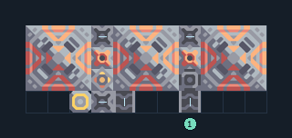

# ย่อยเศษวัสดุ 3 เครื่อง พร้อมเตาหลอม

**PROD-041** · 03 โรงงาน · 11×4 ช่อง · **ทดสอบระบบ**

เหมาะกับ: แปรรูปเศษวัสดุ  
รับ: เศษวัสดุ  
ผลผลิต: ทราย กราไฟต์ ไทเทเนียม ทอเรียม (ผลผลิตสุ่ม ต้องระบายทุกชนิด)  
จุดต่อเมื่อยังไม่หมุน: พิกัดเริ่ม 0 จากซ้ายล่าง  
ผลผลิตออก @ 4,0  
เศษวัสดุ เข้า @ 7,0  
ไฟฟ้า @ 2,0  
ต่อผลผลิตเข้าคลังหรือโรงงานถัดไป เพื่อไม่ให้เครื่องหยุดเพราะทางออกเต็ม  
ผู้สร้างต้นฉบับ: justacommonegg / Design-It (MIT)  
ปรับภาษาไทยและช่องต่อสำหรับชุดนี้  
ตรวจโครงสร้างและการตั้งค่า; อัตราผลิตต้องดูผลทดสอบจริงของแต่ละแบบ  
  
ผลทดสอบ Build 160.7: graphite 0.55/วินาที; sand 0.93/วินาที; thorium 0.42/วินาที; titanium 0.53/วินาที เมื่อป้อนวัตถุดิบที่จุดต่อและมีไฟครบ  
  
หมวด: 03 โรงงาน • Serpulo ไทย 2.0

**วัสดุก่อสร้าง:** ทองแดง 86 · กราไฟต์ 90 · ตะกั่ว 96 · พลาสตาเนียม 120 · ซิลิคอน 480 · ทอเรียม 240 · ไทเทเนียม 325

[ดาวน์โหลด .msch](../../schematics/PROD-041.msch) · [รหัสนำเข้าจากคลิปบอร์ด](../../codes/PROD-041.txt) · [กลับสารบัญ](../INDEX.md)

ภาพประกอบใช้กราฟิกบล็อกจากตัวเกม ไม่ใช่ภาพการรบระหว่างเล่นจริง ทางป้อนต้องจ่ายวัตถุดิบและไฟตามเงื่อนไขที่ระบุ
