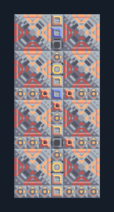

# ย่อยเศษวัสดุ 8 เครื่อง ติดแกนฐาน

**PROD-042** · 03 โรงงาน · 7×15 ช่อง · **ทดสอบระบบ**

เหมาะกับ: ติดแกนฐาน  
รับ: เศษวัสดุ  
ผลผลิต: ทราย กราไฟต์ ไทเทเนียม ทอเรียม (ผลผลิตสุ่ม ต้องระบายทุกชนิด)  
วางแกนฐานหรือคลังขนาด 5×5 ที่จุดกลาง 2,-3 ก่อนวางผัง; ทรัพยากรที่ตั้งไว้ในตัวถอดต้องมีอยู่ในคลัง  
จุดต่อเมื่อยังไม่หมุน: พิกัดเริ่ม 0 จากซ้ายล่าง  
ไฟฟ้า @ 3,2  
ต่อผลผลิตเข้าคลังหรือโรงงานถัดไป เพื่อไม่ให้เครื่องหยุดเพราะทางออกเต็ม  
ผู้สร้างต้นฉบับ: ultimane / Design-It (MIT)  
ปรับภาษาไทยและช่องต่อสำหรับชุดนี้  
ตรวจโครงสร้างและการตั้งค่า; อัตราผลิตต้องดูผลทดสอบจริงของแต่ละแบบ  
  
ผลทดสอบ Build 160.7: graphite 4.48/วินาที; sand 9.52/วินาที; thorium 4.87/วินาที; titanium 4.28/วินาที เมื่อป้อนวัตถุดิบที่จุดต่อและมีไฟครบ  
  
หมวด: 03 โรงงาน • Serpulo ไทย 2.0

**วัสดุก่อสร้าง:** ทองแดง 158 · กราไฟต์ 275 · ตะกั่ว 241 · เมตากลาส 40 · ผ้าเฟส 35 · พลาสตาเนียม 320 · ซิลิคอน 1759 · ทอเรียม 640 · ไทเทเนียม 1245

[ดาวน์โหลด .msch](../../schematics/PROD-042.msch) · [รหัสนำเข้าจากคลิปบอร์ด](../../codes/PROD-042.txt) · [กลับสารบัญ](../INDEX.md)

ภาพประกอบใช้กราฟิกบล็อกจากตัวเกม ไม่ใช่ภาพการรบระหว่างเล่นจริง ทางป้อนต้องจ่ายวัตถุดิบและไฟตามเงื่อนไขที่ระบุ
