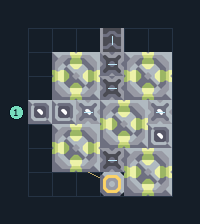

# ถ่านหินจากน้ำมัน 5 เครื่อง ต่อขยาย

**PROD-043** · 03 โรงงาน · 6×7 ช่อง · **ทดสอบระบบ**

เหมาะกับ: ป้อนน้ำมัน  
รับ: น้ำมัน  
ผลผลิต: ถ่านหิน  
จุดต่อเมื่อยังไม่หมุน: พิกัดเริ่ม 0 จากซ้ายล่าง  
น้ำมัน เข้า @ 0,3  
ผลผลิตออก @ 3,6  
ไฟฟ้า @ 3,0  
ต่อผลผลิตเข้าคลังหรือโรงงานถัดไป เพื่อไม่ให้เครื่องหยุดเพราะทางออกเต็ม  
ผู้สร้างต้นฉบับ: xnuuizh / Design-It (MIT)  
ปรับภาษาไทยและช่องต่อสำหรับชุดนี้  
ตรวจโครงสร้างและการตั้งค่า; อัตราผลิตต้องดูผลทดสอบจริงของแต่ละแบบ  
  
ผลทดสอบ Build 160.7: coal 5.00/วินาที เมื่อป้อนวัตถุดิบที่จุดต่อและมีไฟครบ  
  
หมวด: 03 โรงงาน • Serpulo ไทย 2.0

**วัสดุก่อสร้าง:** ทองแดง 21 · กราไฟต์ 220 · ตะกั่ว 174 · เมตากลาส 22 · ไทเทเนียม 100

[ดาวน์โหลด .msch](../../schematics/PROD-043.msch) · [รหัสนำเข้าจากคลิปบอร์ด](../../codes/PROD-043.txt) · [กลับสารบัญ](../INDEX.md)

ภาพประกอบใช้กราฟิกบล็อกจากตัวเกม ไม่ใช่ภาพการรบระหว่างเล่นจริง ทางป้อนต้องจ่ายวัตถุดิบและไฟตามเงื่อนไขที่ระบุ
