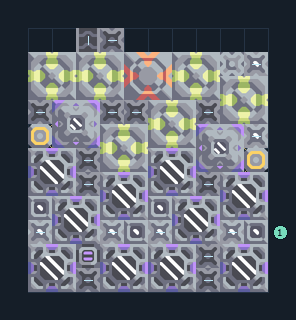

# ถ่านหินจากน้ำและสปอร์ 6 เครื่อง

**PROD-045** · 03 โรงงาน · 10×11 ช่อง · **ทดสอบระบบ**

เหมาะกับ: ผลิตต่อเนื่องจากน้ำ  
รับ: น้ำ  
ผลผลิต: ถ่านหิน  
เครื่องเพาะสปอร์ใช้ไฟฟ้าและน้ำอย่างต่อเนื่อง; พื้นสปอร์เพิ่มผลผลิต แต่ไม่แทนการจ่ายน้ำ  
โอเวอร์ไดรฟ์เพิ่มความต้องการทรัพยากร น้ำ และไฟฟ้า; เริ่มโดยปิดโอเวอร์ไดรฟ์จนแหล่งป้อนเพียงพอ  
จุดต่อเมื่อยังไม่หมุน: พิกัดเริ่ม 0 จากซ้ายล่าง  
ผลผลิตออก @ 2,10  
น้ำ เข้า @ 9,2  
ไฟฟ้า @ 9,5  
ต่อผลผลิตเข้าคลังหรือโรงงานถัดไป เพื่อไม่ให้เครื่องหยุดเพราะทางออกเต็ม  
ผู้สร้างต้นฉบับ: krangpq / Design-It (MIT)  
ปรับภาษาไทยและช่องต่อสำหรับชุดนี้  
ตรวจโครงสร้างและการตั้งค่า; อัตราผลิตต้องดูผลทดสอบจริงของแต่ละแบบ  
  
ผลทดสอบ Build 160.7: coal 5.97/วินาที เมื่อป้อนวัตถุดิบที่จุดต่อและมีไฟครบ  
  
หมวด: 03 โรงงาน • Serpulo ไทย 2.0

**วัสดุก่อสร้าง:** ทองแดง 326 · กราไฟต์ 289 · ตะกั่ว 678 · เมตากลาส 64 · พลาสตาเนียม 30 · ซิลิคอน 235 · ไทเทเนียม 195

[ดาวน์โหลด .msch](../../schematics/PROD-045.msch) · [รหัสนำเข้าจากคลิปบอร์ด](../../codes/PROD-045.txt) · [กลับสารบัญ](../INDEX.md)

ภาพประกอบใช้กราฟิกบล็อกจากตัวเกม ไม่ใช่ภาพการรบระหว่างเล่นจริง ทางป้อนต้องจ่ายวัตถุดิบและไฟตามเงื่อนไขที่ระบุ
