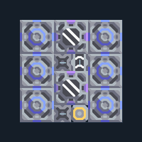

# สปอร์ 2 เครื่อง พร้อมเครื่องสกัดน้ำ

**PROD-046** · 03 โรงงาน · 6×6 ช่อง · **ทดสอบระบบ**

เหมาะกับ: ผลิตน้ำในชุด  
รับ:   
ผลผลิต: สปอร์  
เครื่องสกัดน้ำวางบนพื้นดินที่สร้างได้; ตรวจน้ำจริงหลังเปิดโรงงานและอย่าแบ่งน้ำไปโหลดอื่นจนขาด  
เครื่องเพาะสปอร์ใช้ไฟฟ้าและน้ำอย่างต่อเนื่อง; พื้นสปอร์เพิ่มผลผลิต แต่ไม่แทนการจ่ายน้ำ  
จ่ายทรัพยากรตามตัวถอดที่ตั้งชนิดไว้ในผัง  
จุดต่อเมื่อยังไม่หมุน: พิกัดเริ่ม 0 จากซ้ายล่าง  
สปอร์ ออก @ 2,0  
ไฟฟ้า @ 3,0  
ต่อผลผลิตเข้าคลังหรือโรงงานถัดไป เพื่อไม่ให้เครื่องหยุดเพราะทางออกเต็ม  
ผู้สร้างต้นฉบับ: xnuuizh / Design-It (MIT)  
ปรับภาษาไทยและช่องต่อสำหรับชุดนี้  
ตรวจโครงสร้างและการตั้งค่า; อัตราผลิตต้องดูผลทดสอบจริงของแต่ละแบบ  
  
ผลทดสอบ Build 160.7: spore-pod 0.60/วินาที เมื่อป้อนวัตถุดิบที่จุดต่อและมีไฟครบ  
  
หมวด: 03 โรงงาน • Serpulo ไทย 2.0

**วัสดุก่อสร้าง:** ทองแดง 244 · กราไฟต์ 180 · ตะกั่ว 248 · เมตากลาส 181 · ซิลิคอน 20

[ดาวน์โหลด .msch](../../schematics/PROD-046.msch) · [รหัสนำเข้าจากคลิปบอร์ด](../../codes/PROD-046.txt) · [กลับสารบัญ](../INDEX.md)

ภาพประกอบใช้กราฟิกบล็อกจากตัวเกม ไม่ใช่ภาพการรบระหว่างเล่นจริง ทางป้อนต้องจ่ายวัตถุดิบและไฟตามเงื่อนไขที่ระบุ
