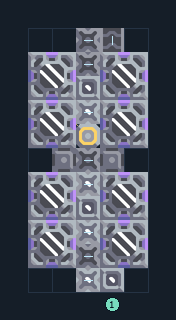

# สปอร์ 8 เครื่อง รับน้ำภายนอก

**PROD-047** · 03 โรงงาน · 5×11 ช่อง · **ทดสอบระบบ**

เหมาะกับ: ป้อนน้ำ  
รับ: น้ำ  
ผลผลิต: สปอร์  
เครื่องเพาะสปอร์ใช้ไฟฟ้าและน้ำอย่างต่อเนื่อง; พื้นสปอร์เพิ่มผลผลิต แต่ไม่แทนการจ่ายน้ำ  
จุดต่อเมื่อยังไม่หมุน: พิกัดเริ่ม 0 จากซ้ายล่าง  
น้ำ เข้า @ 3,0  
ผลผลิตออก @ 3,10  
ไฟฟ้า @ 2,6  
ต่อผลผลิตเข้าคลังหรือโรงงานถัดไป เพื่อไม่ให้เครื่องหยุดเพราะทางออกเต็ม  
ผู้สร้างต้นฉบับ: xnuuizh / Design-It (MIT)  
ปรับภาษาไทยและช่องต่อสำหรับชุดนี้  
ตรวจโครงสร้างและการตั้งค่า; อัตราผลิตต้องดูผลทดสอบจริงของแต่ละแบบ  
  
ผลทดสอบ Build 160.7: spore-pod 4.80/วินาที เมื่อป้อนวัตถุดิบที่จุดต่อและมีไฟครบ  
  
หมวด: 03 โรงงาน • Serpulo ไทย 2.0

**วัสดุก่อสร้าง:** ทองแดง 233 · กราไฟต์ 28 · ตะกั่ว 230 · เมตากลาส 38 · ซิลิคอน 80

[ดาวน์โหลด .msch](../../schematics/PROD-047.msch) · [รหัสนำเข้าจากคลิปบอร์ด](../../codes/PROD-047.txt) · [กลับสารบัญ](../INDEX.md)

ภาพประกอบใช้กราฟิกบล็อกจากตัวเกม ไม่ใช่ภาพการรบระหว่างเล่นจริง ทางป้อนต้องจ่ายวัตถุดิบและไฟตามเงื่อนไขที่ระบุ
