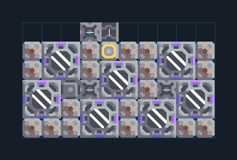

# สปอร์ 7 เครื่อง พร้อมปั๊มน้ำ

**PROD-048** · 03 โรงงาน · 10×6 ช่อง · **ทดสอบระบบ**

เหมาะกับ: ใช้แอ่งน้ำ  
รับ:   
ผลผลิต: สปอร์  
ปั๊มเล็กต้องอยู่บนน้ำ ส่วนเครื่องเพาะสปอร์อยู่บนพื้นดินข้างแอ่งน้ำ  
เครื่องเพาะสปอร์ใช้ไฟฟ้าและน้ำอย่างต่อเนื่อง; พื้นสปอร์เพิ่มผลผลิต แต่ไม่แทนการจ่ายน้ำ  
จุดต่อเมื่อยังไม่หมุน: พิกัดเริ่ม 0 จากซ้ายล่าง  
ผลผลิตออก @ 4,5  
ไฟฟ้า @ 4,4  
ต่อผลผลิตเข้าคลังหรือโรงงานถัดไป เพื่อไม่ให้เครื่องหยุดเพราะทางออกเต็ม  
ผู้สร้างต้นฉบับ: xnuuizh / Design-It (MIT)  
ปรับภาษาไทยและช่องต่อสำหรับชุดนี้  
ตรวจโครงสร้างและการตั้งค่า; อัตราผลิตต้องดูผลทดสอบจริงของแต่ละแบบ  
  
ผลทดสอบ Build 160.7: spore-pod 4.20/วินาที เมื่อป้อนวัตถุดิบที่จุดต่อและมีไฟครบ  
  
หมวด: 03 โรงงาน • Serpulo ไทย 2.0

**วัสดุก่อสร้าง:** ทองแดง 469 · ตะกั่ว 199 · เมตากลาส 180 · ซิลิคอน 70

[ดาวน์โหลด .msch](../../schematics/PROD-048.msch) · [รหัสนำเข้าจากคลิปบอร์ด](../../codes/PROD-048.txt) · [กลับสารบัญ](../INDEX.md)

ภาพประกอบใช้กราฟิกบล็อกจากตัวเกม ไม่ใช่ภาพการรบระหว่างเล่นจริง ทางป้อนต้องจ่ายวัตถุดิบและไฟตามเงื่อนไขที่ระบุ
