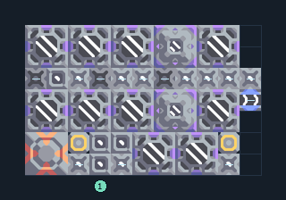

# น้ำมันจากสปอร์ 2 เครื่อง รับน้ำ

**PROD-049** · 03 โรงงาน · 11×7 ช่อง · **ทดสอบระบบ**

เหมาะกับ: ผลิตต่อเนื่องจากน้ำ  
รับ: น้ำ  
ผลผลิต: น้ำมัน  
เครื่องเพาะสปอร์ใช้ไฟฟ้าและน้ำอย่างต่อเนื่อง; พื้นสปอร์เพิ่มผลผลิต แต่ไม่แทนการจ่ายน้ำ  
โอเวอร์ไดรฟ์เพิ่มความต้องการทรัพยากร น้ำ และไฟฟ้า; เริ่มโดยปิดโอเวอร์ไดรฟ์จนแหล่งป้อนเพียงพอ  
จุดต่อเมื่อยังไม่หมุน: พิกัดเริ่ม 0 จากซ้ายล่าง  
น้ำ เข้า @ 3,0  
ของเหลวออก @ 10,3  
ไฟฟ้า @ 2,1  
ต่อผลผลิตเข้าคลังหรือโรงงานถัดไป เพื่อไม่ให้เครื่องหยุดเพราะทางออกเต็ม  
ผู้สร้างต้นฉบับ: .stod / Design-It (MIT)  
ปรับภาษาไทยและช่องต่อสำหรับชุดนี้  
ตรวจโครงสร้างและการตั้งค่า; อัตราผลิตต้องดูผลทดสอบจริงของแต่ละแบบ  
  
ผลทดสอบ Build 160.7: oil 53.71/วินาที เมื่อป้อนวัตถุดิบที่จุดต่อและมีไฟครบ  
  
หมวด: 03 โรงงาน • Serpulo ไทย 2.0

**วัสดุก่อสร้าง:** ทองแดง 272 · กราไฟต์ 56 · ตะกั่ว 450 · เมตากลาส 89 · พลาสตาเนียม 30 · ซิลิคอน 235 · ไทเทเนียม 77

[ดาวน์โหลด .msch](../../schematics/PROD-049.msch) · [รหัสนำเข้าจากคลิปบอร์ด](../../codes/PROD-049.txt) · [กลับสารบัญ](../INDEX.md)

ภาพประกอบใช้กราฟิกบล็อกจากตัวเกม ไม่ใช่ภาพการรบระหว่างเล่นจริง ทางป้อนต้องจ่ายวัตถุดิบและไฟตามเงื่อนไขที่ระบุ
