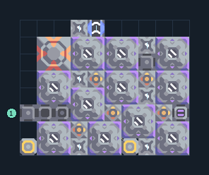

# บีบสปอร์เป็นน้ำมัน 11 เครื่อง

**PROD-051** · 03 โรงงาน · 10×8 ช่อง · **ทดสอบระบบ**

เหมาะกับ: ป้อนสปอร์  
รับ: สปอร์  
ผลผลิต: น้ำมัน  
โอเวอร์ไดรฟ์เพิ่มความต้องการทรัพยากร น้ำ และไฟฟ้า; เริ่มโดยปิดโอเวอร์ไดรฟ์จนแหล่งป้อนเพียงพอ  
จุดต่อเมื่อยังไม่หมุน: พิกัดเริ่ม 0 จากซ้ายล่าง  
สปอร์ เข้า @ 0,2  
ของเหลวออก @ 4,7  
ไฟฟ้า @ 6,0  
ต่อผลผลิตเข้าคลังหรือโรงงานถัดไป เพื่อไม่ให้เครื่องหยุดเพราะทางออกเต็ม  
ผู้สร้างต้นฉบับ: y0. / Design-It (MIT)  
ปรับภาษาไทยและช่องต่อสำหรับชุดนี้  
ตรวจโครงสร้างและการตั้งค่า; อัตราผลิตต้องดูผลทดสอบจริงของแต่ละแบบ  
  
ผลทดสอบ Build 160.7: oil 60.12/วินาที เมื่อป้อนวัตถุดิบที่จุดต่อและมีไฟครบ  
  
หมวด: 03 โรงงาน • Serpulo ไทย 2.0

**วัสดุก่อสร้าง:** ทองแดง 21 · กราไฟต์ 29 · ตะกั่ว 501 · เมตากลาส 49 · พลาสตาเนียม 30 · ซิลิคอน 555 · ไทเทเนียม 202

[ดาวน์โหลด .msch](../../schematics/PROD-051.msch) · [รหัสนำเข้าจากคลิปบอร์ด](../../codes/PROD-051.txt) · [กลับสารบัญ](../INDEX.md)

ภาพประกอบใช้กราฟิกบล็อกจากตัวเกม ไม่ใช่ภาพการรบระหว่างเล่นจริง ทางป้อนต้องจ่ายวัตถุดิบและไฟตามเงื่อนไขที่ระบุ
