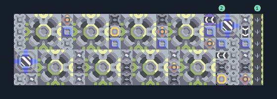

# สกัดน้ำมัน 8 เครื่อง ต่อขยาย

**PROD-054** · 03 โรงงาน · 21×6 ช่อง · **ทดสอบระบบ**

เหมาะกับ: ป้อนจากสายพานและน้ำ  
รับ: ทราย, น้ำ  
ผลผลิต: น้ำมัน  
วางตัวสกัดน้ำมันทั้งหมดบนหินดินดานหรือทรายดำ ป้อนทรายและน้ำจากภายนอก  
ตัวสกัดน้ำมันต้องทับหินดินดานหรือทรายดำที่มีค่าผลิตน้ำมัน; พื้นหินทั่วไปให้ผลผลิตเป็นศูนย์  
จุดต่อเมื่อยังไม่หมุน: พิกัดเริ่ม 0 จากซ้ายล่าง  
น้ำมัน ออก @ 1,0  
ทราย เข้า @ 20,5  
น้ำ เข้า @ 17,4  
ไฟฟ้า @ 17,0  
ต่อผลผลิตเข้าคลังหรือโรงงานถัดไป เพื่อไม่ให้เครื่องหยุดเพราะทางออกเต็ม  
ผู้สร้างต้นฉบับ: sem_1906 / Design-It (MIT)  
ปรับภาษาไทยและช่องต่อสำหรับชุดนี้  
ตรวจโครงสร้างและการตั้งค่า; อัตราผลิตต้องดูผลทดสอบจริงของแต่ละแบบ  
  
ผลทดสอบ Build 160.7: oil 210.00/วินาที เมื่อป้อนวัตถุดิบที่จุดต่อและมีไฟครบ  
  
หมวด: 03 โรงงาน • Serpulo ไทย 2.0

**วัสดุก่อสร้าง:** ทองแดง 1252 · กราไฟต์ 1470 · ตะกั่ว 980 · เมตากลาส 281 · ผ้าเฟส 30 · พลาสตาเนียม 7 · ซิลิคอน 798 · ทอเรียม 922 · ไทเทเนียม 205

[ดาวน์โหลด .msch](../../schematics/PROD-054.msch) · [รหัสนำเข้าจากคลิปบอร์ด](../../codes/PROD-054.txt) · [กลับสารบัญ](../INDEX.md)

ภาพประกอบใช้กราฟิกบล็อกจากตัวเกม ไม่ใช่ภาพการรบระหว่างเล่นจริง ทางป้อนต้องจ่ายวัตถุดิบและไฟตามเงื่อนไขที่ระบุ
