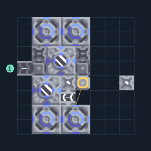

# ไครโอ 2 เครื่อง พร้อมเครื่องสกัดน้ำ

**PROD-055** · 03 โรงงาน · 8×8 ช่อง · **ทดสอบระบบ**

เหมาะกับ: ผลิตน้ำในชุด  
รับ: ไทเทเนียม  
ผลผลิต: ไครโอฟลูอิด  
เครื่องสกัดน้ำวางบนพื้นดินที่สร้างได้; ตรวจน้ำจริงหลังเปิดโรงงานและอย่าแบ่งน้ำไปโหลดอื่นจนขาด  
จุดต่อเมื่อยังไม่หมุน: พิกัดเริ่ม 0 จากซ้ายล่าง  
ไทเทเนียม เข้า @ 0,4  
ไครโอฟลูอิด ออก @ 7,3  
ไฟฟ้า @ 4,3  
ต่อผลผลิตเข้าคลังหรือโรงงานถัดไป เพื่อไม่ให้เครื่องหยุดเพราะทางออกเต็ม  
ผู้สร้างต้นฉบับ: y0. / Design-It (MIT)  
ปรับภาษาไทยและช่องต่อสำหรับชุดนี้  
ตรวจโครงสร้างและการตั้งค่า; อัตราผลิตต้องดูผลทดสอบจริงของแต่ละแบบ  
  
ผลทดสอบ Build 160.7: cryofluid 24.00/วินาที เมื่อป้อนวัตถุดิบที่จุดต่อและมีไฟครบ  
  
หมวด: 03 โรงงาน • Serpulo ไทย 2.0

**วัสดุก่อสร้าง:** ทองแดง 141 · กราไฟต์ 128 · ตะกั่ว 268 · เมตากลาส 137 · ซิลิคอน 80 · ไทเทเนียม 120

[ดาวน์โหลด .msch](../../schematics/PROD-055.msch) · [รหัสนำเข้าจากคลิปบอร์ด](../../codes/PROD-055.txt) · [กลับสารบัญ](../INDEX.md)

ภาพประกอบใช้กราฟิกบล็อกจากตัวเกม ไม่ใช่ภาพการรบระหว่างเล่นจริง ทางป้อนต้องจ่ายวัตถุดิบและไฟตามเงื่อนไขที่ระบุ
