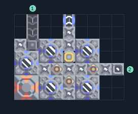

# ไครโอ 5 เครื่อง รับน้ำและไทเทเนียม

**PROD-056** · 03 โรงงาน · 9×7 ช่อง · **ทดสอบระบบ**

เหมาะกับ: ป้อนจากสายพานและน้ำ  
รับ: น้ำ, ไทเทเนียม  
ผลผลิต: ไครโอฟลูอิด  
โอเวอร์ไดรฟ์เพิ่มความต้องการทรัพยากร น้ำ และไฟฟ้า; เริ่มโดยปิดโอเวอร์ไดรฟ์จนแหล่งป้อนเพียงพอ  
จุดต่อเมื่อยังไม่หมุน: พิกัดเริ่ม 0 จากซ้ายล่าง  
ไทเทเนียม เข้า @ 1,6  
ของเหลวออก @ 4,6  
น้ำ เข้า @ 8,2  
ไฟฟ้า @ 4,3  
ต่อผลผลิตเข้าคลังหรือโรงงานถัดไป เพื่อไม่ให้เครื่องหยุดเพราะทางออกเต็ม  
ผู้สร้างต้นฉบับ: justacommonegg / Design-It (MIT)  
ปรับภาษาไทยและช่องต่อสำหรับชุดนี้  
ตรวจโครงสร้างและการตั้งค่า; อัตราผลิตต้องดูผลทดสอบจริงของแต่ละแบบ  
  
ผลทดสอบ Build 160.7: cryofluid 89.51/วินาที เมื่อป้อนวัตถุดิบที่จุดต่อและมีไฟครบ  
  
หมวด: 03 โรงงาน • Serpulo ไทย 2.0

**วัสดุก่อสร้าง:** ทองแดง 7 · กราไฟต์ 36 · ตะกั่ว 431 · เมตากลาส 67 · พลาสตาเนียม 30 · ซิลิคอน 365 · ไทเทเนียม 452

[ดาวน์โหลด .msch](../../schematics/PROD-056.msch) · [รหัสนำเข้าจากคลิปบอร์ด](../../codes/PROD-056.txt) · [กลับสารบัญ](../INDEX.md)

ภาพประกอบใช้กราฟิกบล็อกจากตัวเกม ไม่ใช่ภาพการรบระหว่างเล่นจริง ทางป้อนต้องจ่ายวัตถุดิบและไฟตามเงื่อนไขที่ระบุ
