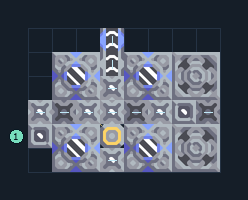

# ไครโอ 4 เครื่อง ขุดไทเทเนียมในชุด

**PROD-057** · 03 โรงงาน · 8×6 ช่อง · **ทดสอบระบบ**

เหมาะกับ: ขุดและผลิตในชุดเดียว  
รับ: น้ำ  
ผลผลิต: ไครโอฟลูอิด  
วางเครื่องเจาะลมบนไทเทเนียม; รับน้ำภายนอก  
จุดต่อเมื่อยังไม่หมุน: พิกัดเริ่ม 0 จากซ้ายล่าง  
น้ำ เข้า @ 0,1  
ของเหลวออก @ 3,5  
ไฟฟ้า @ 3,1  
ต่อผลผลิตเข้าคลังหรือโรงงานถัดไป เพื่อไม่ให้เครื่องหยุดเพราะทางออกเต็ม  
ผู้สร้างต้นฉบับ: plent / Design-It (MIT)  
ปรับภาษาไทยและช่องต่อสำหรับชุดนี้  
ตรวจโครงสร้างและการตั้งค่า; อัตราผลิตต้องดูผลทดสอบจริงของแต่ละแบบ  
  
ผลทดสอบ Build 160.7: cryofluid 48.00/วินาที เมื่อป้อนวัตถุดิบที่จุดต่อและมีไฟครบ  
  
หมวด: 03 โรงงาน • Serpulo ไทย 2.0

**วัสดุก่อสร้าง:** ทองแดง 56 · กราไฟต์ 52 · ตะกั่ว 284 · เมตากลาส 54 · ซิลิคอน 160 · ไทเทเนียม 242

[ดาวน์โหลด .msch](../../schematics/PROD-057.msch) · [รหัสนำเข้าจากคลิปบอร์ด](../../codes/PROD-057.txt) · [กลับสารบัญ](../INDEX.md)

ภาพประกอบใช้กราฟิกบล็อกจากตัวเกม ไม่ใช่ภาพการรบระหว่างเล่นจริง ทางป้อนต้องจ่ายวัตถุดิบและไฟตามเงื่อนไขที่ระบุ
