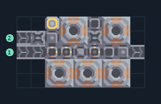

# เมตากลาส 5 เตา เริ่มต้น ทรายและตะกั่ว

**PROD-061** · 03 โรงงาน · 9×5 ช่อง · **ทดสอบระบบ**

เหมาะกับ: เริ่มต้นหลังมีกราไฟต์  
รับ: ตะกั่ว, ทราย  
ผลผลิต: เมตากลาส  
ผังนี้ใช้ทองแดง ตะกั่ว และกราไฟต์ สร้างได้ก่อนมีไทเทเนียม; ป้อนทรายและตะกั่วแยกกัน และต่อไฟ; สายพานธรรมดามีอัตราต่ำกว่าแบบไทเทเนียม  
จุดต่อเมื่อยังไม่หมุน: พิกัดเริ่ม 0 จากซ้ายล่าง  
ตะกั่ว เข้า @ 0,2  
ทราย เข้า @ 0,3  
ผลผลิตออก @ 8,2  
ไฟฟ้า @ 2,4  
ต่อผลผลิตเข้าคลังหรือโรงงานถัดไป เพื่อไม่ให้เครื่องหยุดเพราะทางออกเต็ม  
ผู้สร้างต้นฉบับ: Anchovy (เผยแพร่โดย plent) / Design-It (MIT)  
ปรับภาษาไทยและช่องต่อสำหรับชุดนี้  
ตรวจโครงสร้างและการตั้งค่า; อัตราผลิตต้องดูผลทดสอบจริงของแต่ละแบบ  
  
ผลทดสอบ Build 160.7: metaglass 5.00/วินาที เมื่อป้อนวัตถุดิบที่จุดต่อและมีไฟครบ  
  
หมวด: 03 โรงงาน • Serpulo ไทย 2.0

**วัสดุก่อสร้าง:** ทองแดง 341 · กราไฟต์ 150 · ตะกั่ว 178

[ดาวน์โหลด .msch](../../schematics/PROD-061.msch) · [รหัสนำเข้าจากคลิปบอร์ด](../../codes/PROD-061.txt) · [กลับสารบัญ](../INDEX.md)

ภาพประกอบใช้กราฟิกบล็อกจากตัวเกม ไม่ใช่ภาพการรบระหว่างเล่นจริง ทางป้อนต้องจ่ายวัตถุดิบและไฟตามเงื่อนไขที่ระบุ
