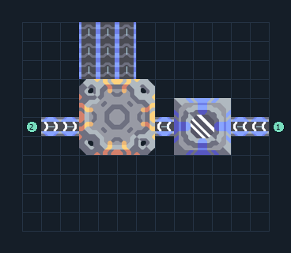

# รับ ถ่านหิน อัตราสูง

**RECEIVE-FAST-coal** · 08 ส่งรับ v8 · 13×11 ช่อง · **ทดสอบระบบ**

รับจริงประมาณ 1100/นาที  
ผลทดสอบแคมเปญประมาณ 1100 สินค้า/นาที เมื่อภายนอกส่ง 1200/นาทีและทางออกโล่ง; เพดานสูตรของแท่นไม่ใช่ผลผลิตจริงของผัง  
รับน้ำภายนอกอย่างน้อย 300/วินาที ต่อสองทางเข้าได้ แท่นใช้ 1500 น้ำ/100สินค้า ไม่มีการผลิตน้ำในแบบนี้  
  
เข้า น้ำ ที่ (12,5) หลัก; 300/วินาทีรวม  
เข้า น้ำ ที่ (1,5) เสริม  
ออก ถ่านหิน ที่ (3,10)  
ออก ถ่านหิน ที่ (4,10)  
ออก ถ่านหิน ที่ (5,10)  
พิกัดจากซ้ายล่างเริ่ม 0 ก่อนหมุน  
ใช้ไฟสูงสุดตามสูตรรวมประมาณ 0/วินาทีเมื่อเครื่องทำงานพร้อมกัน  
  
ผลทดสอบ Build 160.7: รับและระบายของประมาณ 1100 ชิ้น/นาทีในสถานะแคมเปญจำลอง พร้อมน้ำ/ไฟตามจุดต่อ  
  
หมวด: 08 ส่งรับ v8 • Serpulo ไทย 2.0

**วัสดุก่อสร้าง:** ทองแดง 209 · กราไฟต์ 100 · ตะกั่ว 9 · เมตากลาส 45 · ไทเทเนียม 149

[ดาวน์โหลด .msch](../../schematics/RECEIVE-FAST-coal.msch) · [รหัสนำเข้าจากคลิปบอร์ด](../../codes/RECEIVE-FAST-coal.txt) · [กลับสารบัญ](../INDEX.md)

ภาพประกอบใช้กราฟิกบล็อกจากตัวเกม ไม่ใช่ภาพการรบระหว่างเล่นจริง ทางป้อนต้องจ่ายวัตถุดิบและไฟตามเงื่อนไขที่ระบุ
