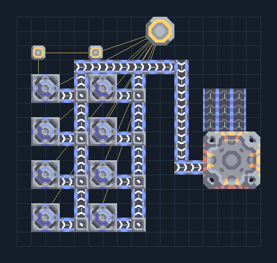

# รับ เศษวัสดุ พร้อมขุดน้ำ

**RECEIVE-START-scrap** · 08 ส่งรับ v8 · 17×16 ช่อง · **ทดสอบระบบ**

รับ 200/นาที  
Water Extractor 8 ตัวรวมฐานน้ำตามสูตร 52.8/วินาทีเมื่อพื้นประสิทธิภาพ 100% เพียงพอเฉลี่ยสำหรับแท่นส่ง 1 ตัว ต้องมีไฟ 720/วินาทีและพื้นรองรับน้ำใต้ดิน  
รอถังแท่นรับมีน้ำ 1500 ก่อนรับเที่ยวแรก  
  
เชื่อมไฟที่เสา (9,14)  
ออก เศษวัสดุ ที่ (13,10)  
ออก เศษวัสดุ ที่ (14,10)  
ออก เศษวัสดุ ที่ (15,10)  
พิกัดจากซ้ายล่างเริ่ม 0 ก่อนหมุน  
ใช้ไฟสูงสุดตามสูตรรวมประมาณ 720/วินาทีเมื่อเครื่องทำงานพร้อมกัน  
  
ผลทดสอบ Build 160.7: รับและระบายของประมาณ 200 ชิ้น/นาทีในสถานะแคมเปญจำลอง พร้อมน้ำ/ไฟตามจุดต่อ  
  
หมวด: 08 ส่งรับ v8 • Serpulo ไทย 2.0

**วัสดุก่อสร้าง:** ทองแดง 453 · กราไฟต์ 372 · ตะกั่ว 271 · เมตากลาส 294 · ซิลิคอน 3 · ไทเทเนียม 190

[ดาวน์โหลด .msch](../../schematics/RECEIVE-START-scrap.msch) · [รหัสนำเข้าจากคลิปบอร์ด](../../codes/RECEIVE-START-scrap.txt) · [กลับสารบัญ](../INDEX.md)

ภาพประกอบใช้กราฟิกบล็อกจากตัวเกม ไม่ใช่ภาพการรบระหว่างเล่นจริง ทางป้อนต้องจ่ายวัตถุดิบและไฟตามเงื่อนไขที่ระบุ
