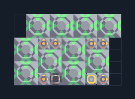

# ซ่อมแนวรบ — Mend Projector 10 ตัว

**SUPPORT101** · 09 สนับสนุนและ Logic · 9×6 ช่อง · **ตรวจผัง**

ฟื้นพลังสิ่งก่อสร้างในแนวรบกว้าง  
ต่อไฟ ถ้าต้องการเร่งซ่อมให้ป้อนผ้าเฟสตามสายที่เตรียมไว้; วางหลังแนวปืน/กำแพง ผังนี้ไม่ยิงศัตรูหรือผลิตไฟ  
  
แหล่ง: Design-It / skyon2  
ต้นฉบับ: mender 10 height 6 extPhase stack (54)  
MIT; แปลชื่อและคู่มือโดยชุด Serpulo ไทย 2.0  
อ่าน/โครงสร้างผ่านแล้ว ผลทดสอบการทำงานเฉพาะรหัสอยู่ในคู่มือ อัตราจริงขึ้นกับแผนที่และวัตถุดิบ  
  
หมวด: 09 สนับสนุนและ Logic • Serpulo ไทย 2.0

**วัสดุก่อสร้าง:** ทองแดง 504 · ตะกั่ว 1008 · ซิลิคอน 580 · ไทเทเนียม 400

[ดาวน์โหลด .msch](../../schematics/SUPPORT101.msch) · [รหัสนำเข้าจากคลิปบอร์ด](../../codes/SUPPORT101.txt) · [กลับสารบัญ](../INDEX.md)

ภาพประกอบใช้กราฟิกบล็อกจากตัวเกม ไม่ใช่ภาพการรบระหว่างเล่นจริง ทางป้อนต้องจ่ายวัตถุดิบและไฟตามเงื่อนไขที่ระบุ
