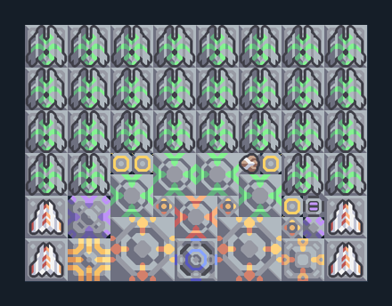

# สนับสนุนแนวรบ — ซ่อมยูนิต โล่และสกัดกระสุน

**SUPPORT106** · 09 สนับสนุนและ Logic · 16×12 ช่อง · **ตรวจผัง**

ช่วยยูนิตแนวหน้าและป้อมปืนด้วยระบบซ่อมรวม  
ต่อไฟ น้ำจากพื้น และผ้าเฟสจาก Core/คลังหรือโดรนส่งของ; มี Repair Turret 28, โล่ 2, Mend 4 และ Segment; เชื่อม processor กับโล่/ซ่อมตามข้อความผู้สร้าง  
มี mlog เดิมฝังในแบบ: ห้ามลบ processor หากยังใช้ระบบอัตโนมัติ; ดูวิธีตั้งค่าของผู้สร้างในคู่มือฉบับเต็ม  
  
แหล่ง: Design-It / y0.  
ต้นฉบับ: Frontline Healing v1.2  
MIT; แปลชื่อและคู่มือโดยชุด Serpulo ไทย 2.0  
อ่าน/โครงสร้างผ่านแล้ว ผลทดสอบการทำงานเฉพาะรหัสอยู่ในคู่มือ อัตราจริงขึ้นกับแผนที่และวัตถุดิบ  
  
เป้าหมายป้อม: hail → พื้นดิน  
  
หมวด: 09 สนับสนุนและ Logic • Serpulo ไทย 2.0

**วัสดุก่อสร้าง:** ทองแดง 373 · กราไฟต์ 112 · ตะกั่ว 1134 · เมตากลาส 30 · ผ้าเฟส 160 · พลาสตาเนียม 1710 · ซิลิคอน 3760 · เซิร์จอัลลอย 15 · ทอเรียม 2610 · ไทเทเนียม 667

[ดาวน์โหลด .msch](../../schematics/SUPPORT106.msch) · [รหัสนำเข้าจากคลิปบอร์ด](../../codes/SUPPORT106.txt) · [กลับสารบัญ](../INDEX.md)

ภาพประกอบใช้กราฟิกบล็อกจากตัวเกม ไม่ใช่ภาพการรบระหว่างเล่นจริง ทางป้อนต้องจ่ายวัตถุดิบและไฟตามเงื่อนไขที่ระบุ
