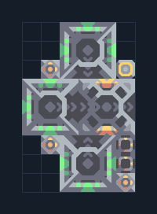

# ยูนิตติด Core — Mono และ Poly แบบพื้นฐาน

**SUPPORT201** · 07 ยูนิต · 6×9 ช่อง · **ตรวจผัง**

สร้างผู้ช่วยฐานจากคลังผ่านโรงงานหลายตัว  
วาง Unloader ชิด Core/คลังที่มีซิลิคอน ตะกั่ว กราไฟต์; ต่อไฟ เว้นทางออกของยูนิต ตรวจ air factory เป็น Mono และ additive รับ payload  
  
แหล่ง: Design-It / stan_twitter  
ต้นฉบับ: Poly (Pulsar) Core Basic  
MIT; แปลชื่อและคู่มือโดยชุด Serpulo ไทย 2.0  
อ่าน/โครงสร้างผ่านแล้ว ผลทดสอบการทำงานเฉพาะรหัสอยู่ในคู่มือ อัตราจริงขึ้นกับแผนที่และวัตถุดิบ  
  
หมวด: 07 ยูนิต • Serpulo ไทย 2.0

**วัสดุก่อสร้าง:** ทองแดง 386 · ตะกั่ว 340 · ซิลิคอน 360 · ไทเทเนียม 75

[ดาวน์โหลด .msch](../../schematics/SUPPORT201.msch) · [รหัสนำเข้าจากคลิปบอร์ด](../../codes/SUPPORT201.txt) · [กลับสารบัญ](../INDEX.md)

ภาพประกอบใช้กราฟิกบล็อกจากตัวเกม ไม่ใช่ภาพการรบระหว่างเล่นจริง ทางป้อนต้องจ่ายวัตถุดิบและไฟตามเงื่อนไขที่ระบุ
