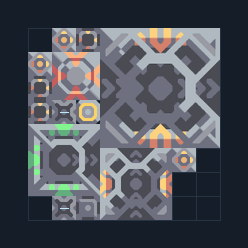

# ยูนิต T3 ติด Core — แบบกะทัดรัด

**SUPPORT202** · 07 ยูนิต · 8×8 ช่อง · **ตรวจผัง**

อัปเกรด T1→T2→T3 จากวัตถุดิบคลัง  
ต่อ Unloader กับ Core/คลังที่มีซิลิคอน ตะกั่ว กราไฟต์ ไทเทเนียม เมตากลาส; ต่อไฟและตรวจ factory plan เว้น payload exit; เปลี่ยนโรงงานต้นทางเฉพาะชนิดที่บล็อกปลายทางรับ  
  
แหล่ง: Design-It / justacommonegg  
ต้นฉบับ: T3 Core 01 (64)  
MIT; แปลชื่อและคู่มือโดยชุด Serpulo ไทย 2.0  
อ่าน/โครงสร้างผ่านแล้ว ผลทดสอบการทำงานเฉพาะรหัสอยู่ในคู่มือ อัตราจริงขึ้นกับแผนที่และวัตถุดิบ  
  
หมวด: 07 ยูนิต • Serpulo ไทย 2.0

**วัสดุก่อสร้าง:** ทองแดง 283 · ตะกั่ว 964 · พลาสตาเนียม 30 · ซิลิคอน 765 · ทอเรียม 650 · ไทเทเนียม 500

[ดาวน์โหลด .msch](../../schematics/SUPPORT202.msch) · [รหัสนำเข้าจากคลิปบอร์ด](../../codes/SUPPORT202.txt) · [กลับสารบัญ](../INDEX.md)

ภาพประกอบใช้กราฟิกบล็อกจากตัวเกม ไม่ใช่ภาพการรบระหว่างเล่นจริง ทางป้อนต้องจ่ายวัตถุดิบและไฟตามเงื่อนไขที่ระบุ
