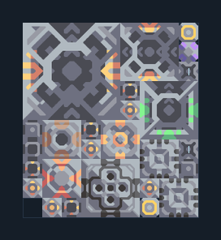

# ยูนิต T3 — ผลิตของจาก Core ในผัง

**SUPPORT203** · 07 ยูนิต · 9×10 ช่อง · **ตรวจผัง**

โรงงานยูนิตพร้อมซิลิคอน กราไฟต์ และเมตากลาส  
ป้อนวัตถุดิบดิบจาก Core/คลังตามสูตรโรงงาน มีโรงงานอุปกรณ์ในตัวและ mlog จัด payload; ต่อไฟและตรวจ unit plan ให้ตรงสายอัปเกรด  
มี mlog เดิมฝังในแบบ: ห้ามลบ processor หากยังใช้ระบบอัตโนมัติ; ดูวิธีตั้งค่าของผู้สร้างในคู่มือฉบับเต็ม  
  
แหล่ง: Design-It / justacommonegg  
ต้นฉบับ: T3 Core Raw 01  
MIT; แปลชื่อและคู่มือโดยชุด Serpulo ไทย 2.0  
อ่าน/โครงสร้างผ่านแล้ว ผลทดสอบการทำงานเฉพาะรหัสอยู่ในคู่มือ อัตราจริงขึ้นกับแผนที่และวัตถุดิบ  
  
หมวด: 07 ยูนิต • Serpulo ไทย 2.0

**วัสดุก่อสร้าง:** ทองแดง 642 · กราไฟต์ 30 · ตะกั่ว 1139 · เมตากลาส 80 · พลาสตาเนียม 65 · ซิลิคอน 935 · ทอเรียม 650 · ไทเทเนียม 670

[ดาวน์โหลด .msch](../../schematics/SUPPORT203.msch) · [รหัสนำเข้าจากคลิปบอร์ด](../../codes/SUPPORT203.txt) · [กลับสารบัญ](../INDEX.md)

ภาพประกอบใช้กราฟิกบล็อกจากตัวเกม ไม่ใช่ภาพการรบระหว่างเล่นจริง ทางป้อนต้องจ่ายวัตถุดิบและไฟตามเงื่อนไขที่ระบุ
