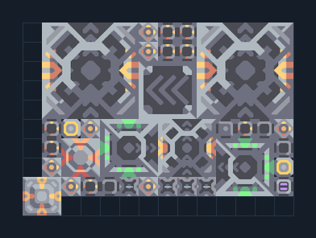

# Mega คู่ — โรงงานผู้ช่วยฐานจาก Core

**SUPPORT204** · 07 ยูนิต · 14×10 ช่อง · **ตรวจผัง**

ผลิตยูนิต T3 ช่วยซ่อมและขนส่งสองปลายทาง  
วาง Unloader ชิด Core/คลังที่มีวัสดุยูนิต T1–T3 ต่อไฟและตรวจ Air Factory เป็น Mono; Payload Router แบ่งไป Multiplicative สองเครื่อง เว้นช่องปล่อยออก  
  
แหล่ง: Design-It / justacommonegg  
ต้นฉบับ: T3 Core 2x Mega  
MIT; แปลชื่อและคู่มือโดยชุด Serpulo ไทย 2.0  
อ่าน/โครงสร้างผ่านแล้ว ผลทดสอบการทำงานเฉพาะรหัสอยู่ในคู่มือ อัตราจริงขึ้นกับแผนที่และวัตถุดิบ  
  
หมวด: 07 ยูนิต • Serpulo ไทย 2.0

**วัสดุก่อสร้าง:** ทองแดง 388 · กราไฟต์ 20 · ตะกั่ว 1718 · พลาสตาเนียม 30 · ซิลิคอน 1395 · ทอเรียม 1300 · ไทเทเนียม 1050

[ดาวน์โหลด .msch](../../schematics/SUPPORT204.msch) · [รหัสนำเข้าจากคลิปบอร์ด](../../codes/SUPPORT204.txt) · [กลับสารบัญ](../INDEX.md)

ภาพประกอบใช้กราฟิกบล็อกจากตัวเกม ไม่ใช่ภาพการรบระหว่างเล่นจริง ทางป้อนต้องจ่ายวัตถุดิบและไฟตามเงื่อนไขที่ระบุ
